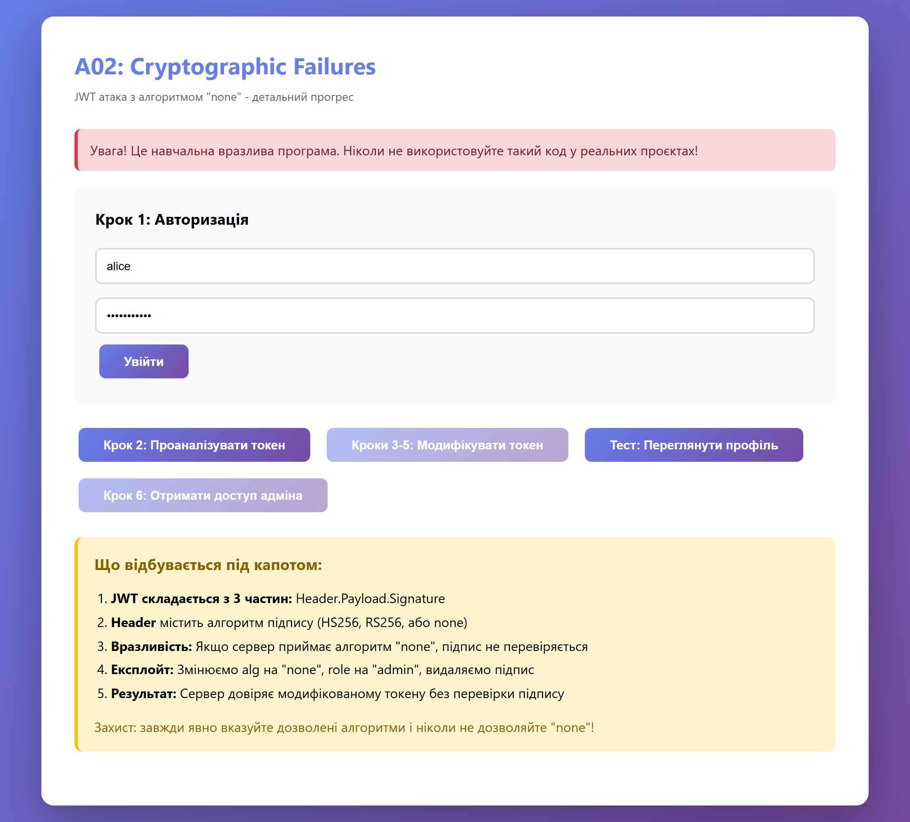

[🏠 Головна](../README.md) · [⬅ A01 Broken Access Control](../A01_BrokenAccessControl/README.md) · [A03 Injection ➡](../A03_Injection/README.md)

> 🔄 **OWASP Top 10:2025:** ця лабораторна відповідає категорії **A04:2025 — Cryptographic Failures** (у 2021 — A02). [Що змінилось у 2025 →](../README.md#-owasp-top-102025--що-змінилось)

# 🔐 A02: Cryptographic Failures — Node.js Лабораторна робота



## 🎯 Мета
Навчитися виявляти, експлуатувати та виправляти **криптографічні помилки** у реалізації JWT-аутентифікації, зокрема **використання слабкого секрету** та **відсутність перевірки алгоритму підпису**.

---

## 🚫 Вразливість (Умисно вставлена)

1. **Слабкий JWT секрет**: У `.env` використано `mysecret123` — простий, легко підібрати.
2. **Відсутність перевірки алгоритму**: Сервер приймає JWT з `alg: none`, навіть якщо оригінальний токен був підписаний через `HS256`.

### Приклад атаки:
1. Користувач `alice` входить — отримує JWT.
2. Він відкриває [jwt.io](https://jwt.io), копіює токен.
3. Змінює `alg: HS256` → `alg: none`.
4. Змінює `role: "user"` → `role: "admin"`.
5. **Видаляє підпис** (він не потрібен при `none`).
6. Вставляє новий токен у браузер — **отримує доступ до адмін-панелі!**

Це — **JWT Signature Bypass via Algorithm Switching** — **найпоширеніша атака на JWT**.

---

## 🔍 Як виявити?

- Використовуйте Burp Suite або DevTools — перехопіть JWT після входу.
- Перейдіть на [jwt.io](https://jwt.io) — перевірте:
    - Який алгоритм (`alg`) використовується?
    - Чи можна змінити `alg` на `none`?
    - Чи можна змінити `role` без помилки?
- Спробуйте відправити токен з `alg: none` через Postman/JS — чи отримуєте доступ?

> Питання: Чи вимагає сервер підпис, якщо `alg: none`? **Якщо ні — це вразливість!**

---

## ✅ Як виправити?

**Правильний підхід:**  
**Завжди перевіряйте, що алгоритм підпису — це той, що очікується.**

### Виправлення (`server.js`):

```javascript
// ВИПРАВЛЕНО: Перевіряємо, що алгоритм — HS256
app.get('/profile', (req, res) => {
  const authHeader = req.headers.authorization;
  if (!authHeader || !authHeader.startsWith('Bearer ')) {
    return res.status(401).json({ error: 'Token required' });
  }

  const token = authHeader.substring(7);

  try {
    // КЛЮЧОВА ПЕРЕВІРКА: перевіряємо, що алгоритм — HS256
    const header = jwt.decode(token, { complete: true }); // Дістаємо заголовок
    if (header?.header.alg !== 'HS256') {
      return res.status(403).json({ 
        error: 'Invalid algorithm. Only HS256 is allowed.' 
      });
    }

    // Тепер безпечно перевіряємо підпис
    const decoded = jwt.verify(token, process.env.JWT_SECRET);
    res.json({ success: true, user: { id: decoded.userId, username: decoded.username, role: decoded.role } });
  } catch (err) {
    res.status(403).json({ success: false, error: 'Invalid or expired token' });
  }
});

// Аналогічно для /admin
```

---

[🏠 Головна](../README.md) · [⬅ A01 Broken Access Control](../A01_BrokenAccessControl/README.md) · [A03 Injection ➡](../A03_Injection/README.md)
