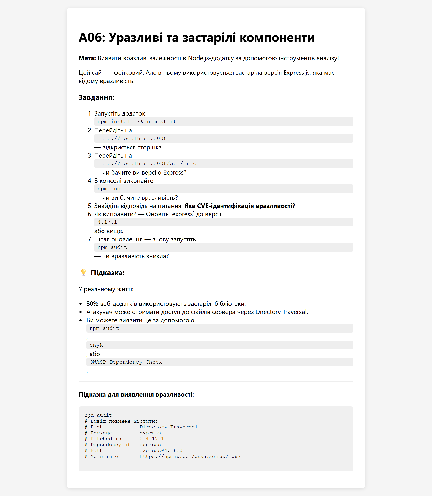

[🏠 Головна](../README.md) · [⬅ A05 Security Misconfiguration](../A05_SecurityMisconfiguration/README.md) · [A07 Auth Failures ➡](../A07_IdentAuthFailures/README.md)

> 🔄 **OWASP Top 10:2025:** ця лабораторна відповідає категорії **A03:2025 — Software Supply Chain Failures** (у 2021 — A06 Vulnerable and Outdated Components; категорію розширено). [Що змінилось у 2025 →](../README.md#-owasp-top-102025--що-змінилось)

# 🧩 A06: Vulnerable and Outdated Components — Node.js Лабораторна робота



## 🎯 Мета
Навчитися виявляти, експлуатувати та виправляти **вразливі та застарілі залежності** у Node.js-додатках — зокрема, використання **відомої вразливості в `express@4.16.0`**.

## 🚫 Вразливість (Умисно вставлена)

У цьому додатку використовується **застаріла версія Express.js**:

```json
"dependencies": {
  "express": "4.16.0"  // ← ВРАЗЛИВА ВЕРСІЯ!
}
```

---

[🏠 Головна](../README.md) · [⬅ A05 Security Misconfiguration](../A05_SecurityMisconfiguration/README.md) · [A07 Auth Failures ➡](../A07_IdentAuthFailures/README.md)
