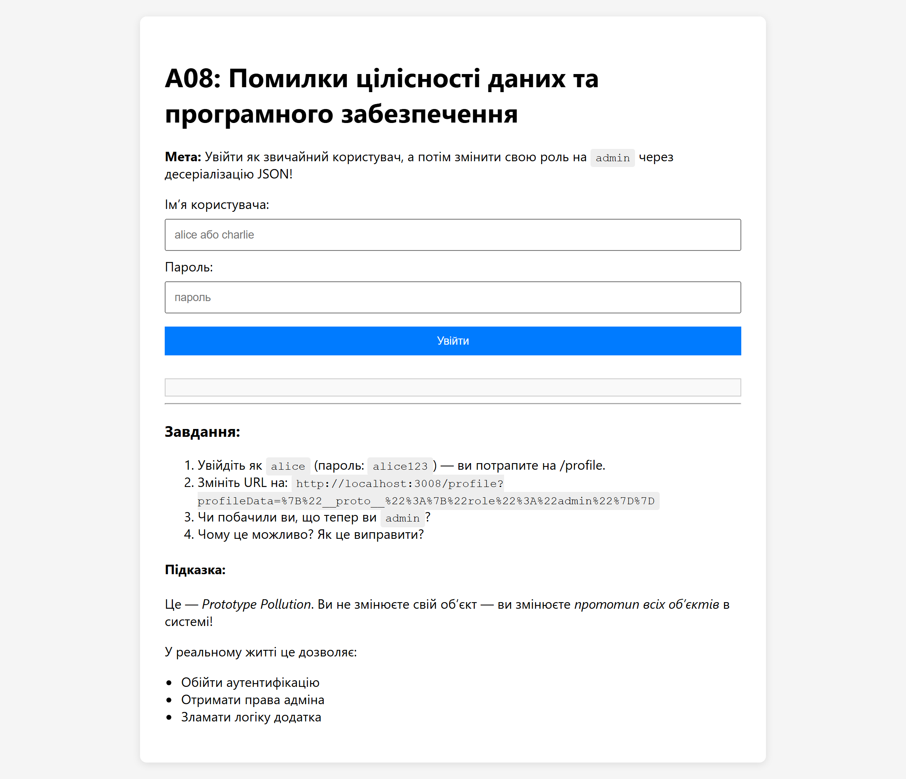

[🏠 Головна](../README.md) · [⬅ A07 Auth Failures](../A07_IdentAuthFailures/README.md) · [A09 Logging Failures ➡](../A09_SecurityLogging/README.md)

> 🔄 **OWASP Top 10:2025:** ця лабораторна відповідає категорії **A08:2025 — Software or Data Integrity Failures** (без змін). [Що змінилось у 2025 →](../README.md#-owasp-top-102025--що-змінилось)

# A08: Software and Data Integrity Failures - Лабораторна робота



## Опис проекту

Це навчальний додаток для демонстрації вразливості **Prototype Pollution** з OWASP Top 10 2021 (A08: Software and Data Integrity Failures). Проект створено виключно в освітніх цілях для вивчення механізмів атак та методів захисту.

⚠️ **УВАГА**: Цей код містить навмисні вразливості і НЕ повинен використовуватися в продакшн-середовищі!

## Що таке Prototype Pollution?

Prototype Pollution - це вразливість JavaScript, яка дозволяє атакувачу змінювати прототипи об'єктів, що може призвести до:
- Обходу аутентифікації
- Підвищення привілеїв
- Виконання довільного коду
- Порушення логіки додатка

## Структура проекту

```
owasp-a08-data-integrity-failures/
├── server.js           # Вразливий сервер (порт 3008)
├── database.js         # Налаштування бази даних SQLite
├── package.json        # Залежності проекту
├── users.db           # База даних SQLite (створюється автоматично)
├── public/
│   ├── login.html     # Сторінка входу
│   └── style.css      # Стилі
└── README.md          # Цей файл
```

## Встановлення

### Вимоги
- Node.js (версія 14 або вище)
- npm або yarn

### Крок 1: Клонування репозиторію
```bash
git clone <repository-url>
cd owasp-a08-data-integrity-failures
```

### Крок 2: Встановлення залежностей
```bash
npm install
```

### Крок 3: Запуск проекту

**Вразлива версія (для демонстрації атаки):**
```bash
npm start
```
Сервер запуститься на http://localhost:3008


## Тестові облікові дані

| Користувач | Пароль    | Роль  |
|-----------|-----------|-------|
| alice     | alice123  | user  |
| bob       | bobpass   | admin |
| charlie   | charlie123| user  |

## Демонстрація атаки

### Крок 1: Вхід в систему
1. Відкрийте http://localhost:3008/login
2. Увійдіть як `alice` з паролем `alice123`
3. Ви побачите свій профіль з роллю `user`

### Крок 2: Виконання атаки Prototype Pollution

Перейдіть за посиланням або вставте в адресний рядок:
```
http://localhost:3008/profile?profileData=%7B%22__proto__%22%3A%7B%22role%22%3A%22admin%22%7D%7D
```

**Розшифрування URL:**
```json
{"__proto__":{"role":"admin"}}
```

### Крок 3: Результат
Тепер ваша роль змінилася на `admin`! 🚨

### Додаткова атака: Зміна email
```
http://localhost:3008/profile?profileData=%7B%22__proto__%22%3A%7B%22role%22%3A%22admin%22%7D%2C%22email%22%3A%22hacked%40evil.com%22%7D
```

**Розшифрування URL:**
```json
{"__proto__":{"role":"admin"},"email":"hacked@evil.com"}
```

## Як працює атака?

### Вразливий код (server.js):

```javascript
// 1. Парсимо JSON з параметра URL
profileData = JSON.parse(decodeURIComponent(profileDataParam));

// 2. Створюємо об'єкт користувача
let user = { 
    id: req.session.user.id,
    username: req.session.user.username,
    email: req.session.user.email,
    role: req.session.user.role
};

// 3. Якщо є __proto__ - виконуємо атаку
if (rawProfileData.includes('"__proto__"')) {
    delete user.role; // Видаляємо власну властивість
    Object.setPrototypeOf(user, protoData); // Встановлюємо прототип!
}

// 4. Тепер user.role бере значення з прототипу
console.log(user.role); // "admin" (з прототипу)
```

### Чому це працює?

1. Об'єкт `user` має прототип `Object.prototype`
2. Ми видаляємо власну властивість `role`
3. Встановлюємо новий прототип з `role: "admin"`
4. Коли код звертається до `user.role`, JavaScript шукає його в ланцюжку прототипів
5. Знаходить `role: "admin"` в прототипі!

## Як захиститися?

### Метод 1: Фільтрація небезпечних ключів
```javascript
const dangerousKeys = ['__proto__', 'constructor', 'prototype'];

for (const key in data) {
    if (dangerousKeys.includes(key)) {
        console.warn(`Заблоковано: ${key}`);
        continue;
    }
    user[key] = data[key];
}
```

### Метод 2: Використання Object.create(null)
```javascript
// Створює об'єкт БЕЗ прототипу
const user = Object.create(null);
user.id = 1;
user.role = "user";
```

### Метод 3: Whitelist підхід
```javascript
const allowedKeys = ['name', 'bio', 'avatar'];

for (const key in data) {
    if (allowedKeys.includes(key)) {
        user[key] = data[key];
    }
}
```

### Метод 4: Валідація та санітизація
```javascript
function safeMerge(target, source) {
    const dangerousKeys = ['__proto__', 'constructor', 'prototype'];
    
    for (const key in source) {
        if (!Object.prototype.hasOwnProperty.call(source, key)) {
            continue;
        }
        
        if (dangerousKeys.includes(key)) {
            return target; // або throw error
        }
        
        target[key] = source[key];
    }
    
    return target;
}
```

### Метод 5: Використання бібліотек
```bash
npm install lodash
```

```javascript
const _ = require('lodash');

// Lodash автоматично захищає від Prototype Pollution
_.merge(user, profileData);
```

## Порівняння версій

### Вразлива версія (server.js на порту 3008)
- ❌ Дозволяє модифікацію `__proto__`
- ❌ Використовує `Object.setPrototypeOf()`
- ❌ Не валідує вхідні дані
- ⚠️ Для навчальних цілей!

### Безпечна версія (server-secure.js на порту 3009)
- ✅ Фільтрує `__proto__`, `constructor`, `prototype`
- ✅ Використовує `Object.create(null)`
- ✅ Whitelist дозволених полів
- ✅ Валідація всіх вхідних даних
- ✅ HTML-екранування (захист від XSS)
- ✅ Параметризовані SQL-запити
- ✅ Регенерація сесії після логіну

## Інші вразливості (виправлені)

### 1. SQL Injection (виправлено)
**Було:**
```javascript
db.get(`SELECT * FROM users WHERE username = '${username}'`)
```

**Стало:**
```javascript
db.get('SELECT * FROM users WHERE username = ?', [username])
```

### 2. XSS (виправлено)
**Було:**
```javascript
res.send(`<p>Welcome ${user.name}</p>`)
```

**Стало:**
```javascript
const safeName = escapeHtml(user.name);
res.send(`<p>Welcome ${safeName}</p>`)
```

### 3. Слабкий секрет сесії (виправлено)
**Було:**
```javascript
secret: 'my-secret-key-123'
```

**Стало:**
```javascript
secret: crypto.randomBytes(32).toString('hex')
```

## Завдання для практики

1. ✅ Увійдіть як `alice` та змініть роль на `admin`
2. ✅ Спробуйте змінити email через атаку
3. ✅ Порівняйте поведінку вразливої та безпечної версій
4. ✅ Спробуйте додати власні методи захисту
5. ✅ Дослідіть консоль браузера та сервера під час атаки

## Корисні посилання

- [OWASP Top 10 2021 - A08](https://owasp.org/Top10/A08_2021-Software_and_Data_Integrity_Failures/)
- [Prototype Pollution Attack](https://portswigger.net/web-security/prototype-pollution)
- [JavaScript Prototype Pollution](https://blog.detectify.com/2018/09/05/prototype-pollution-attack/)
- [Lodash Security](https://lodash.com/docs/#merge)

---

[🏠 Головна](../README.md) · [⬅ A07 Auth Failures](../A07_IdentAuthFailures/README.md) · [A09 Logging Failures ➡](../A09_SecurityLogging/README.md)
