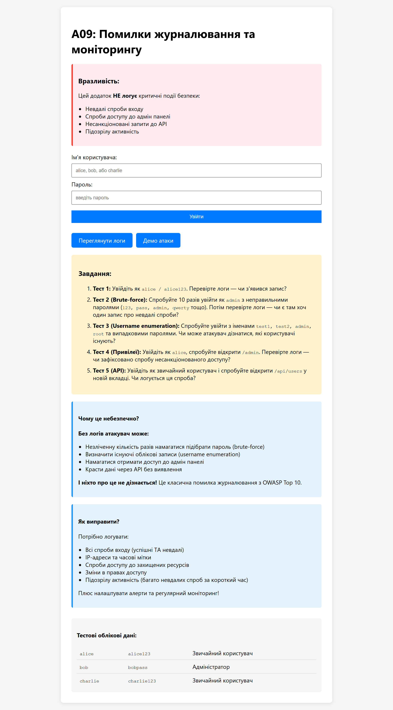
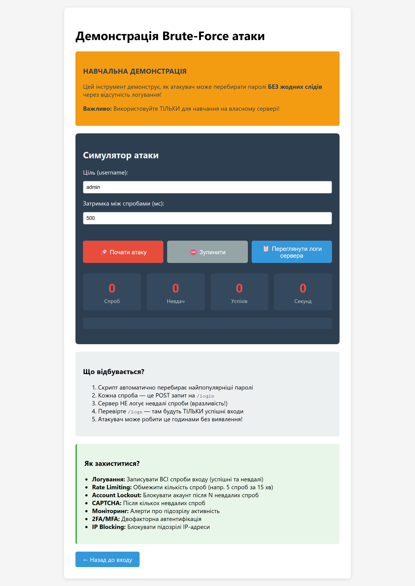
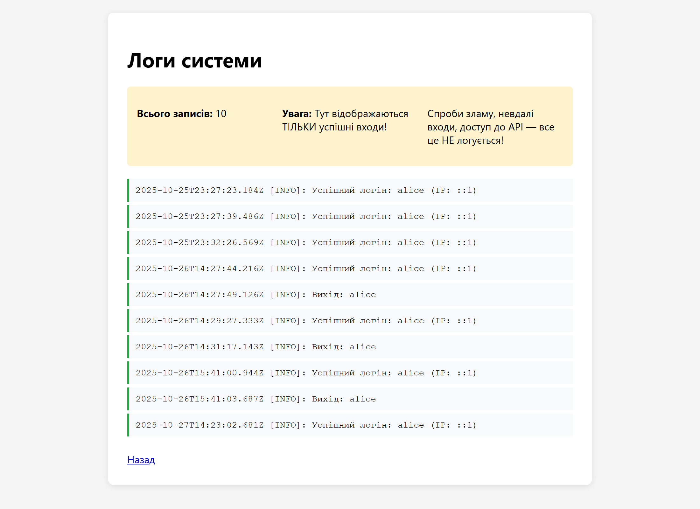

# 🔒 OWASP A09: Security Logging and Monitoring Failures

> **Лабораторна робота з кібербезпеки**  
> Навчальний проєкт для демонстрації вразливостей, пов'язаних з відсутністю належного журналювання та моніторингу

---

## 📋 Зміст

- [Про проєкт](#-про-проєкт)
- [Вразливості](#-вразливості)
- [Встановлення](#-встановлення)
- [Запуск](#-запуск)
- [Структура проєкту](#-структура-проєкту)
- [Лабораторні завдання](#-лабораторні-завдання)
- [Демонстрація атак](#-демонстрація-атак)
- [Як виправити](#-як-виправити)
- [Тестові дані](#-тестові-дані)
- [Скріншоти](#-скріншоти)
- [Попередження](#-попередження)

---

## 🎯 Про проєкт

Це **навмисно вразливий веб-додаток**, створений для демонстрації проблем із журналюванням подій безпеки згідно з [OWASP Top 10 2021 - A09](https://owasp.org/Top10/A09_2021-Security_Logging_and_Monitoring_Failures/).

### Що таке A09?

**Security Logging and Monitoring Failures** — це вразливість, коли додаток не журналює критичні події безпеки (невдалі спроби входу, несанкціоновані дії, підозрілу активність), що дозволяє атакувачам діяти непомітно.

### Навчальні цілі

Після виконання лабораторної роботи студенти зможуть:

- ✅ Розуміти, чому логування критично важливе для безпеки
- ✅ Виявляти відсутність логування в додатках
- ✅ Проводити brute-force атаки на системи без моніторингу
- ✅ Реалізовувати правильне логування подій безпеки
- ✅ Налаштовувати алерти та моніторинг

---

## 🐛 Вразливості

### 1. **Відсутність логування невдалих спроб входу** 🔴
- Атакувач може безкінечно перебирати паролі
- Brute-force атаки залишаються непоміченими
- Неможливо виявити спроби злому

### 2. **Не логується доступ до привілейованих ресурсів** 🟠
- Спроби доступу до `/admin` не фіксуються
- Неможливо відстежити elevation of privilege атаки
- Несанкціоновані дії залишаються непоміченими

### 3. **API без аудиту** 🟡
- Запити до `/api/users` не логуються
- Витік даних може відбутися непомітно
- Немає контролю за доступом до чутливих даних

### 4. **Відсутність rate limiting** 🟢
- Необмежена кількість запитів з одного IP
- Можливість DDoS атак
- Немає захисту від автоматизованих атак

### 5. **Консольне логування замість централізованого** 🔵
- `console.log` замість logger
- Логи не зберігаються
- Неможливість ретроспективного аналізу

---

## 💻 Встановлення

### Вимоги

- Node.js >= 14.x
- npm >= 6.x

### Крок 1: Клонування репозиторію

```bash
git clone <repository-url>
cd owasp-a09-security-logging
```

### Крок 2: Встановлення залежностей

```bash
npm install
```

### Крок 3: Ініціалізація бази даних

База даних SQLite створюється автоматично при першому запуску:

```bash
node database.js
```

---

## 🚀 Запуск

### Режим розробки (з автоперезавантаженням)

```bash
npm run dev
```

### Звичайний режим

```bash
npm start
```

Сервер запуститься на `http://localhost:3009`

### Доступні URL

| URL | Опис |
|-----|------|
| `http://localhost:3009/login` | Форма входу |
| `http://localhost:3009/profile` | Профіль користувача |
| `http://localhost:3009/admin` | Адміністративна панель |
| `http://localhost:3009/logs` | Перегляд логів (незахищено!) |
| `http://localhost:3009/attack-demo` | Симулятор brute-force атаки |
| `http://localhost:3009/api/users` | API користувачів |

---

## 📁 Структура проєкту

```
owasp-a09-security-logging/
├── server.js              # Основний сервер (з вразливостями)
├── database.js            # Ініціалізація SQLite БД
├── package.json           # Залежності проєкту
├── README.md              # Документація
├── logs/                  # Директорія для логів
│   └── access.log         # Файл логів (тільки успішні входи!)
├── public/                # Статичні файли
│   ├── login.html         # Форма входу
│   ├── attack-demo.html   # Демонстрація атаки
│   └── style.css          # Стилі
└── users.db               # SQLite база даних
```

---

## 🎓 Лабораторні завдання

### Завдання 1: Успішний вхід і логування ✅

**Мета:** Переконатися, що успішні входи логуються

1. Відкрийте `http://localhost:3009/login`
2. Увійдіть як `alice` / `alice123`
3. Перейдіть на `http://localhost:3009/logs`
4. **Питання:** Чи бачите ви запис про успішний логін?

**Очікуваний результат:** ✅ Так, успішний вхід залогувався

---

### Завдання 2: Brute-Force атака 🔴

**Мета:** Виявити відсутність логування невдалих спроб

1. Спробуйте увійти як `admin` з паролями:
    - `123456`
    - `password`
    - `admin123`
    - `qwerty`
    - `letmein`
      (повторіть 10 разів з різними паролями)

2. Перевірте логи на `http://localhost:3009/logs`

**Питання:**
- Чи є записи про невдалі спроби?
- Скільки записів ви бачите?
- Чи може адміністратор виявити атаку?

**Очікуваний результат:** ❌ Жодного запису про невдалі спроби!

---

### Завдання 3: Username Enumeration 🟠

**Мета:** Визначити існуючі акаунти через brute-force

1. Спробуйте увійти з такими іменами користувачів:
    - `test1` / `anypassword`
    - `admin` / `anypassword`
    - `root` / `anypassword`
    - `alice` / `wrongpass`

2. Зверніть увагу на відповіді сервера

**Питання:**
- Чи відрізняються повідомлення для існуючих і неіснуючих користувачів?
- Чи може атакувач визначити валідні імена користувачів?
- Чи логуються ці спроби?

**Очікуваний результат:** Атакувач може визначити існуючі акаунти БЕЗ логування

---

### Завдання 4: Privilege Escalation 🟡

**Мета:** Перевірити логування спроб несанкціонованого доступу

1. Увійдіть як `alice` / `alice123` (звичайний користувач)
2. Спробуйте відкрити `http://localhost:3009/admin`
3. Перевірте логи

**Питання:**
- Чи отримали ви доступ?
- Чи залогувалася спроба несанкціонованого доступу?
- Що побачить адміністратор в логах?

**Очікуваний результат:** ❌ Спроба доступу НЕ залогувалася!

---

### Завдання 5: API Data Exfiltration 🔵

**Мета:** Виявити відсутність аудиту API

1. Увійдіть як звичайний користувач (`alice`)
2. Відкрийте `http://localhost:3009/api/users` у новій вкладці
3. Перевірте логи

**Питання:**
- Чи отримали ви доступ до даних?
- Чи залогувався запит до API?
- Чи може атакувач красти дані непомітно?

**Очікуваний результат:** ❌ API запити НЕ логуються!

---

## 🎯 Демонстрація атак

### Автоматизована Brute-Force атака

1. Відкрийте `http://localhost:3009/attack-demo`
2. Залfollow інструкції на сторінці
3. Натисніть **"Почати атаку"**
4. Спостерігайте за:
    - Кількістю спроб
    - Швидкістю атаки
    - Результатами

5. **ПІД ЧАС АТАКИ** відкрийте `http://localhost:3009/logs` в іншій вкладці

**Що ви побачите:**
- ✅ Атака виконується швидко та ефективно
- ✅ Скрипт перебирає 20 найпопулярніших паролів
- ❌ В логах НІЧОГО не з'являється під час атаки
- ✅ Тільки коли пароль знайдено — з'явиться один запис

**Висновок:** Атакувач може робити тисячі спроб БЕЗ виявлення!

---

## ✅ Як виправити?

### 1. Логування ВСІХ спроб автентифікації

```javascript
// ❌ ПОГАНО
if (!user) {
    return res.send('Неправильний пароль');
}

// ✅ ДОБРЕ
if (!user) {
    logger.warn(`Невдала спроба входу: ${username} (IP: ${req.ip})`);
    return res.send('Неправильний пароль');
}
```

### 2. Деталізоване логування

Логувати потрібно:
- Часову мітку (timestamp)
- IP-адресу
- User-Agent
- Ім'я користувача (спроба)
- Тип події (успіх/невдача)
- Критичність (info/warn/error)

### 3. Rate Limiting

```javascript
const rateLimit = require('express-rate-limit');

const loginLimiter = rateLimit({
    windowMs: 15 * 60 * 1000, // 15 хвилин
    max: 5, // Максимум 5 спроб
    message: 'Занадто багато спроб. Спробуйте через 15 хвилин.'
});

app.post('/login', loginLimiter, (req, res) => {
    // ...
});
```

### 4. Account Lockout

```javascript
// Блокувати акаунт після 5 невдалих спроб
if (failedAttempts >= 5) {
    logger.error(`Акаунт заблоковано: ${username} (IP: ${req.ip})`);
    return res.send('Акаунт тимчасово заблоковано');
}
```

### 5. Алерти та моніторинг

```javascript
// Алерт при підозрілій активності
if (failedAttemptsInLastHour > 50) {
    alertSecurityTeam({
        type: 'BRUTE_FORCE_DETECTED',
        ip: req.ip,
        target: username,
        attempts: failedAttemptsInLastHour
    });
}
```

### 6. Централізоване логування

Використовувати:
- Winston + файлові транспорти
- ELK Stack (Elasticsearch, Logstash, Kibana)
- Sentry для помилок
- CloudWatch / Azure Monitor для хмарних сервісів

### 7. Захист логів

```javascript
// ❌ ПОГАНО - логи доступні всім
app.get('/logs', (req, res) => {
    res.send(logs);
});

// ✅ ДОБРЕ - логи тільки для адмінів
app.get('/logs', requireAdmin, (req, res) => {
    logger.info(`Доступ до логів: ${req.user.username}`);
    res.send(logs);
});
```

---

## 🔑 Тестові дані

| Користувач | Пароль | Роль |
|------------|--------|------|
| `alice` | `alice123` | user |
| `bob` | `bobpass` | admin |
| `charlie` | `charlie123` | user |

---

## 📸 Скріншоти

### Форма входу


### Демо атаки


### Порожні логи після атаки


---

## ⚠️ Попередження

### ⛔ ТІЛЬКИ ДЛЯ НАВЧАННЯ!

Цей проєкт містить **навмисні вразливості** і НЕ повинен використовуватися в production середовищі!

**НЕ РОБІТЬ:**
- ❌ Розгортати на публічних серверах
- ❌ Використовувати реальні паролі
- ❌ Зберігати справжні дані користувачів
- ❌ Атакувати сторонні системи

**МОЖНА:**
- ✅ Використовувати для навчання
- ✅ Запускати локально
- ✅ Вивчати вразливості
- ✅ Практикувати захист

---

## 📚 Додаткові ресурси

- [OWASP Top 10 2021 - A09](https://owasp.org/Top10/A09_2021-Security_Logging_and_Monitoring_Failures/)
- [OWASP Logging Cheat Sheet](https://cheatsheetseries.owasp.org/cheatsheets/Logging_Cheat_Sheet.html)
- [CWE-778: Insufficient Logging](https://cwe.mitre.org/data/definitions/778.html)
- [Winston Logger Documentation](https://github.com/winstonjs/winston)

---

## 📝 Звітність

### Що включити в звіт:

1. **Скріншоти:**
    - Успішний вхід і запис в логах
    - Невдала спроба без запису в логах
    - Результати brute-force атаки
    - Порожні логи після численних спроб

2. **Аналіз:**
    - Опис кожної виявленої вразливості
    - Потенційні наслідки для безпеки
    - Сценарії реальних атак

3. **Рекомендації:**
    - Конкретні кроки для виправлення
    - Приклади коду
    - Best practices для логування

---

