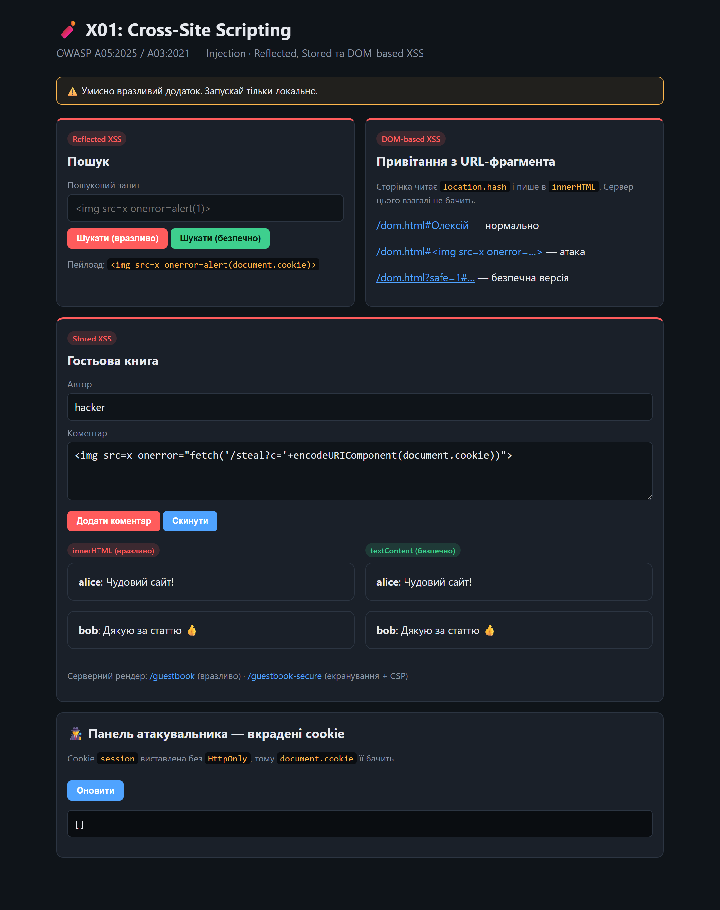

[🏠 Головна](../README.md) · [⬅ A10 SSRF](../A10_SSRF/README.md) · [X02 Command Injection ➡](../X02_CommandInjection/README.md)

# 🧨 X01: Cross-Site Scripting (XSS)

> **OWASP A05:2025 — Injection** (у 2021: A03) · порт **3011** · CWE-79, CWE-1004
>
> ⚠️ Умисно вразливий додаток. Тільки для навчання, тільки на `127.0.0.1`.



## 📋 Зміст

- [Мета](#-мета)
- [Запуск](#-запуск)
- [Вразливості](#-вразливості)
- [Експлуатація](#-експлуатація)
- [Виправлення](#-виправлення)
- [Завдання](#-завдання)
- [Джерела](#-джерела)

---

## 🎯 Мета

Навчитися розрізняти три види XSS — **Reflected**, **Stored** та **DOM-based** — експлуатувати їх для викрадення cookie і захищатися за допомогою контекстного екранування, безпечних DOM-API, `HttpOnly` та **Content-Security-Policy**.

## 🚀 Запуск

```bash
cd X01_XSS
npm install
npm start          # http://127.0.0.1:3011
```

## 🚫 Вразливості

| Ендпоінт | Тип | Що не так |
|---|---|---|
| `GET /search?q=` | Reflected | `q` вставляється в HTML без екранування |
| `POST /api/comments` → `/` | Stored | коментар рендериться через `innerHTML` |
| `GET /guestbook` | Stored | серверний рендер без екранування |
| `/dom.html#…` | DOM-based | `location.hash` → `innerHTML` (сервер навіть не бачить пейлоад) |
| cookie `session` | CWE-1004 | без `HttpOnly` — доступна з `document.cookie` |

Безпечні аналоги: `/search-secure`, `/guestbook-secure` (екранування + CSP), `/dom.html?safe=1` (`textContent`), права колонка гостьової книги.

## 💣 Експлуатація

**1. Reflected XSS**

```
http://127.0.0.1:3011/search?q=
```

**2. Stored XSS + крадіжка cookie.** Додай коментар:

```html

```

Кожен, хто відкриє головну сторінку чи `/guestbook`, віддасть свою cookie. Результат — у блоці «Панель атакувальника» (`GET /api/stolen`).

**3. DOM-based XSS**

```
http://127.0.0.1:3011/dom.html#
```

> Пейлоад у фрагменті `#…` не потрапляє на сервер — WAF і серверні логи його не побачать.

## ✅ Виправлення

```javascript
// 1. Контекстне екранування при серверному рендері
const escapeHtml = s => String(s).replace(/[&<>"']/g, c =>
    ({ '&': '&amp;', '<': '&lt;', '>': '&gt;', '"': '&quot;', "'": '&#39;' }[c]));
res.send(`<p>Ви шукали: <b>${escapeHtml(q)}</b></p>`);

// 2. CSP — навіть пропущений пейлоад не виконається (inline-скрипти заборонені)
res.set('Content-Security-Policy', "default-src 'self'; script-src 'self'; object-src 'none'");

// 3. На клієнті — textContent замість innerHTML
el.textContent = 'Привіт, ' + name;

// 4. Сесійні cookie — тільки HttpOnly
res.cookie('session', id, { httpOnly: true, sameSite: 'lax', secure: true });
```

Для HTML, який *потрібно* дозволити (rich-text), використовуй санітайзер (DOMPurify), а не регулярки.

## 🧪 Завдання

1. Проексплуатуй усі три види XSS та поясни, чим вони відрізняються.
2. Обійди фільтр, якби сервер видаляв лише `<script>` (підказка: `onerror`, `onload`, `<svg>`).
3. Перевір у DevTools → Console, що на `/search-secure` CSP блокує інлайн-обробники.
4. Увімкни `httpOnly: true` в `server.js` і переконайся, що крадіжка cookie перестала працювати.

## 📚 Джерела

- [OWASP Top 10:2025 — A05 Injection](https://top10.owasp.org/2025/A05_2025-Injection/)
- [OWASP XSS Prevention Cheat Sheet](https://cheatsheetseries.owasp.org/cheatsheets/Cross_Site_Scripting_Prevention_Cheat_Sheet.html)
- [OWASP DOM-based XSS Prevention Cheat Sheet](https://cheatsheetseries.owasp.org/cheatsheets/DOM_based_XSS_Prevention_Cheat_Sheet.html)

---

[⬆ До змісту](#-зміст) · [🏠 Головна](../README.md)
