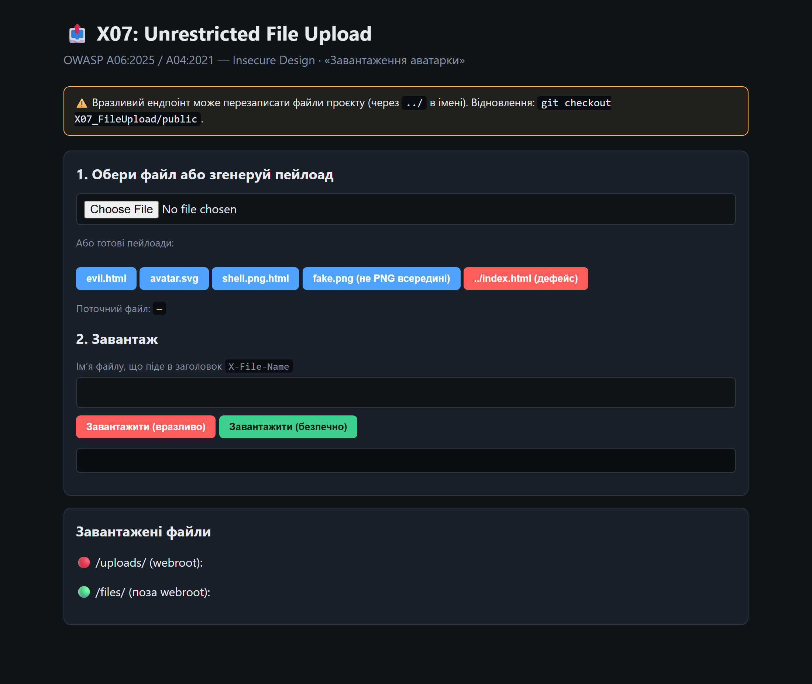

[🏠 Головна](../README.md) · [⬅ X06 Open Redirect](../X06_OpenRedirect/README.md) · [X08 Insecure Deserialization ➡](../X08_InsecureDeserialization/README.md)

# 📤 X07: Unrestricted File Upload

> **OWASP A06:2025 — Insecure Design** (у 2021: A04) · порт **3017** · CWE-434, CWE-22, CWE-79
>
> ⚠️ Вразливий ендпоінт може **перезаписати файли проєкту**. Відновлення: `git checkout X07_FileUpload/public`.



## 📋 Зміст

- [Мета](#-мета)
- [Запуск](#-запуск)
- [Вразливості](#-вразливості)
- [Експлуатація](#-експлуатація)
- [Виправлення](#-виправлення)
- [Завдання](#-завдання)
- [Джерела](#-джерела)

---

## 🎯 Мета

Розібрати, чому функція «завантажити аватарку» — один з найнебезпечніших елементів додатку, і спроєктувати безпечне завантаження: перевірка вмісту, власні імена файлів, зберігання поза webroot.

## 🚀 Запуск

```bash
cd X07_FileUpload
npm install
npm start          # http://127.0.0.1:3017
```

Файл надсилається «сирим» тілом запиту, ім’я — у заголовку `X-File-Name`.

## 🚫 Вразливості

`POST /upload` 🔴:

| Проблема | Наслідок |
|---|---|
| Ім’я файлу від клієнта без санітизації | `../index.html` → **перезапис** файлів поза `uploads/` (дефейс) |
| Немає перевірки типу та вмісту | приймаються `.html`, `.svg`, `.js`, `shell.png.html` |
| Файли лежать у `public/` і віддаються з того ж origin | **Stored XSS** з повним доступом до сайту |

`POST /upload-secure` 🟢: allowlist `png/jpg/gif`, перевірка **magic bytes**, `randomUUID()` як ім’я, зберігання в `storage/` поза webroot, віддача через `/files/:id` з `nosniff` і `CSP: sandbox`.

## 💣 Експлуатація

На сторінці є готові пейлоади:

| Кнопка | Що відбувається |
|---|---|
| `evil.html` | відкрий `/uploads/evil.html` — виконається `<script>` |
| `avatar.svg` | SVG — це XML з JavaScript: `onload=alert()` |
| `shell.png.html` | подвійне розширення обходить перевірку `includes('.png')` |
| `fake.png` | розширення `.png`, а всередині — HTML (безпечна версія відхилить за magic bytes) |
| `../index.html` | перезапис головної сторінки лабораторної |

```bash
curl -X POST http://127.0.0.1:3017/upload -H "X-File-Name: evil.html" \
     --data-binary "<script>alert(document.domain)</script>"
```

> На серверах з PHP/JSP/ASPX такий самий баг дає **веб-шелл і RCE**: завантажуєш `shell.php` — і сервер його виконує.

## ✅ Виправлення

```javascript
const ALLOWED = { png: [0x89, 0x50, 0x4e, 0x47], jpg: [0xff, 0xd8, 0xff], gif: [0x47, 0x49, 0x46, 0x38] };

const ext = path.basename(name).split('.').pop().toLowerCase();
if (!ALLOWED[ext]) return res.status(400)...;                         // allowlist розширень
if (!ALLOWED[ext].every((b, i) => body[i] === b)) return res.status(400)...; // реальний вміст

const id = crypto.randomUUID() + '.' + ext;                           // своє ім’я
fs.writeFileSync(path.join(STORAGE_OUTSIDE_WEBROOT, id), body);       // поза public/

// Віддача
res.set({ 'X-Content-Type-Options': 'nosniff', 'Content-Security-Policy': "default-src 'none'; sandbox" });
```

Також: обмеження розміру, перекодування зображень (sharp), антивірусна перевірка, окремий домен для користувацького контенту (`usercontent.example.com`).

## 🧪 Завдання

1. Завантаж `evil.html` і SVG з XSS, відкрий їх.
2. Зроби дефейс головної сторінки через `../index.html`, потім віднови: `git checkout X07_FileUpload/public`.
3. Спробуй обійти `/upload-secure`: файл з PNG-заголовком і HTML всередині — чи виконається він? Чому (`nosniff`, `sandbox`)?

## 📚 Джерела

- [OWASP Top 10:2025 — A06 Insecure Design](https://top10.owasp.org/2025/A06_2025-Insecure_Design/)
- [OWASP File Upload Cheat Sheet](https://cheatsheetseries.owasp.org/cheatsheets/File_Upload_Cheat_Sheet.html)
- [PortSwigger — File upload vulnerabilities](https://portswigger.net/web-security/file-upload)

---

[⬆ До змісту](#-зміст) · [🏠 Головна](../README.md)
