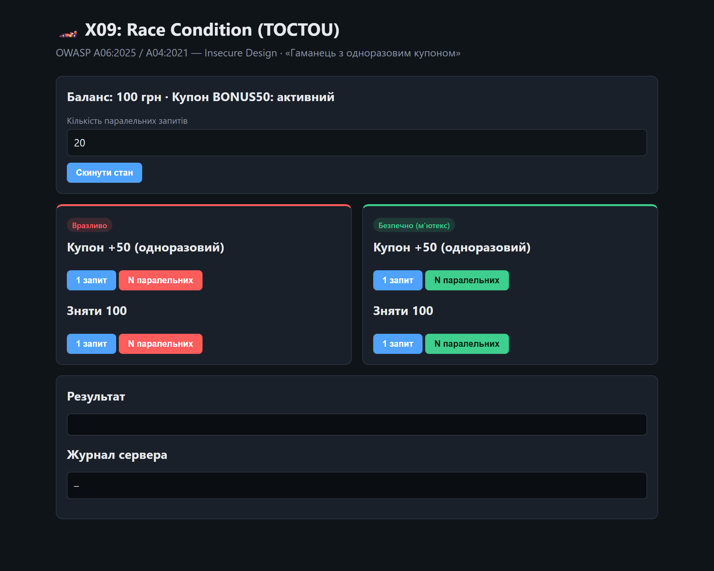

[🏠 Головна](../README.md) · [⬅ X08 Insecure Deserialization](../X08_InsecureDeserialization/README.md) · [X10 CORS / Clickjacking ➡](../X10_CORS_Clickjacking/README.md)

# 🏎️ X09: Race Condition (TOCTOU)

> **OWASP A06:2025 — Insecure Design** (у 2021: A04) · порт **3019** · CWE-362, CWE-367



## 📋 Зміст

- [Мета](#-мета)
- [Запуск](#-запуск)
- [Вразливість](#-вразливість)
- [Експлуатація](#-експлуатація)
- [Виправлення](#-виправлення)
- [Завдання](#-завдання)
- [Джерела](#-джерела)

---

## 🎯 Мета

Показати, що навіть в однопотоковому Node.js бізнес-логіка вразлива до гонок, якщо між **перевіркою** і **дією** є `await`, та навчитися робити операції атомарними.

## 🚀 Запуск

```bash
cd X09_RaceCondition
npm install
npm start          # http://127.0.0.1:3019
```

Стартовий стан: баланс **100**, одноразовий купон **BONUS50** (+50).

## 🚫 Вразливість

```javascript
app.post('/redeem', async (req, res) => {
    if (coupon.used) return res.status(400)...;   // 1. CHECK
    await dbLatency();                              // 2. вікно гонки (запит до БД / платіжки)
    coupon.used = true;                             // 3. ACT
    state.balance += coupon.amount;
});
```

Поки перший запит чекає на `await`, решта паралельних запитів **теж** проходять перевірку `coupon.used === false`.

| Ендпоінт | Статус |
|---|---|
| `POST /redeem`, `POST /withdraw` | 🔴 check → await → act |
| `POST /redeem-secure`, `POST /withdraw-secure` | 🟢 м’ютекс + резервування до `await` |

## 💣 Експлуатація

**З UI:** кнопка «N паралельних».

**Зі скрипта:**

```bash
node attack.js redeem             # купон застосовано 20 разів: баланс 1100 замість 150
node attack.js withdraw           # 20 знять по 100 з балансу 100: баланс -1900
node attack.js redeem secure      # 1 з 20 — захист працює
node attack.js withdraw secure 50 # 50 паралельних запитів
```

Реальні приклади: багаторазове використання подарункових карт і промокодів, подвійне виведення коштів, обхід лімітів («1 голос на користувача»), обхід rate-limit на перебір 2FA-кодів.

> У Burp Suite для цього є «Send group in parallel (single-packet attack)».

## ✅ Виправлення

```javascript
// Усі операції з рахунком — послідовно через м’ютекс
accountLock.run(async () => {
    if (coupon.used) return res.status(400)...;
    coupon.used = true;        // резервуємо ДО будь-якого await
    await dbLatency();
    state.balance += coupon.amount;
});
```

У реальних системах — атомарність на рівні БД:

```sql
-- атомарний check-and-set: оновиться рівно 1 рядок або 0
UPDATE coupons SET used = true WHERE code = $1 AND used = false RETURNING amount;

-- або блокування рядка в транзакції
BEGIN; SELECT balance FROM accounts WHERE id = $1 FOR UPDATE; ...; COMMIT;
```

Також: унікальні індекси (`UNIQUE(user_id, coupon_id)`), idempotency-ключі, розподілені локи (Redis `SET NX`) для кількох інстансів.

## 🧪 Завдання

1. Отримай баланс > 1000 через купон і від’ємний баланс через зняття.
2. Знайди мінімальну затримку `dbLatency`, при якій атака ще працює.
3. Поясни, чому м’ютекс у пам’яті **не допоможе**, якщо запустити 2 інстанси сервера за балансувальником.

## 📚 Джерела

- [OWASP Top 10:2025 — A06 Insecure Design](https://top10.owasp.org/2025/A06_2025-Insecure_Design/)
- [PortSwigger — Race conditions](https://portswigger.net/web-security/race-conditions)
- [CWE-367: TOCTOU Race Condition](https://cwe.mitre.org/data/definitions/367.html)

---

[⬆ До змісту](#-зміст) · [🏠 Головна](../README.md)
