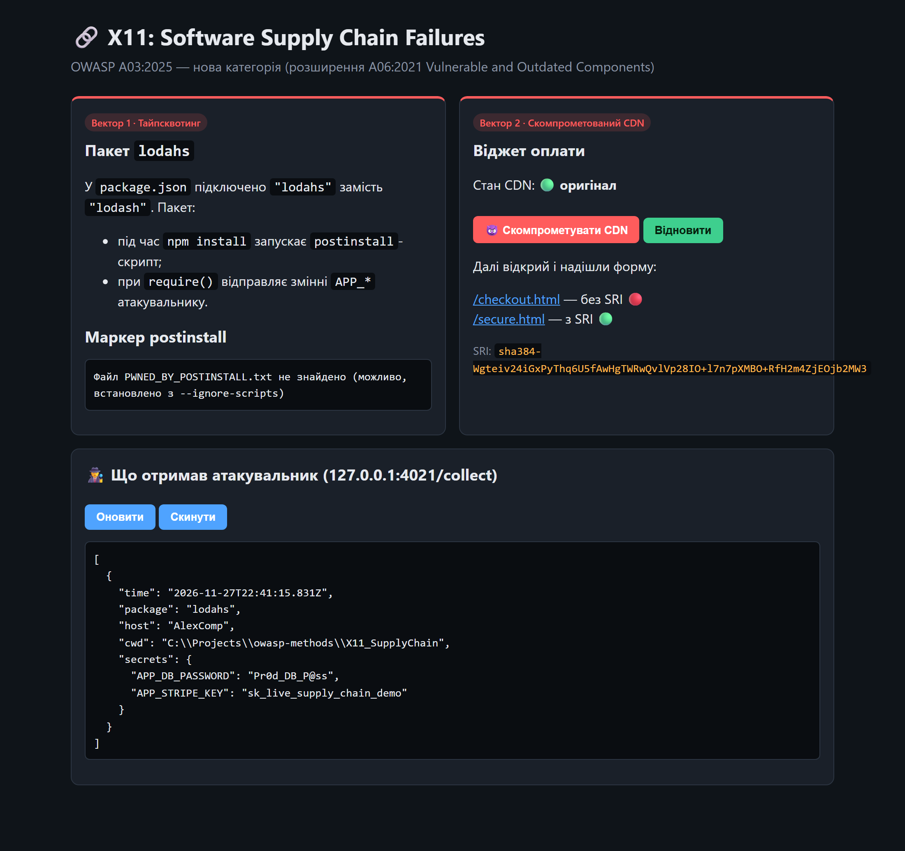

[🏠 Головна](../README.md) · [⬅ X10 CORS / Clickjacking](../X10_CORS_Clickjacking/README.md) · [X12 Exceptional Conditions ➡](../X12_ExceptionalConditions/README.md)

# 🔗 X11: Software Supply Chain Failures

> **OWASP A03:2025 — Software Supply Chain Failures** 🆕 (розширення A06:2021 Vulnerable and Outdated Components) · порти **3021** (магазин) та **4021** (CDN / атакувальник) · CWE-1357, CWE-829, CWE-506, CWE-353
>
> ⚠️ `npm install` у цій папці **запускає postinstall-скрипт навчального «шкідливого» пакета**. Він лише створює файл-маркер `PWNED_BY_POSTINSTALL.txt`, нічого не краде і за межі папки не виходить.



## 📋 Зміст

- [Мета](#-мета)
- [Запуск](#-запуск)
- [Вектор 1 — тайпсквотинг-залежність](#-вектор-1--тайпсквотинг-залежність)
- [Вектор 2 — скомпрометований CDN без SRI](#-вектор-2--скомпрометований-cdn-без-sri)
- [Виправлення](#-виправлення)
- [Завдання](#-завдання)
- [Джерела](#-джерела)

---

## 🎯 Мета

У 2025 OWASP винесла ланцюг постачання ПЗ на **3-тє місце**: атакують не твій код, а те, що ти в нього підтягуєш, тобто npm-пакети, CDN-скрипти та build-пайплайн. Лабораторна показує два найпоширеніші сценарії й захист від них.

## 🚀 Запуск

```bash
cd X11_SupplyChain
npm install        # ← тут вже спрацює postinstall «lodahs»
npm start          # http://127.0.0.1:3021
```

| Сторінка | Опис |
|---|---|
| http://127.0.0.1:3021 | панель лабораторної: стан CDN, вкрадені дані |
| http://127.0.0.1:3021/checkout.html | оплата, віджет **без SRI** 🔴 |
| http://127.0.0.1:3021/secure.html | оплата, віджет **з SRI** 🟢 |

## 📦 Вектор 1 — тайпсквотинг-залежність

У `package.json` підключено **`lodahs`**, а не `lodash`:

```json
"dependencies": { "lodahs": "file:./packages/lodahs" }
```

Пакет повноцінно працює (`chunk`, `capitalize`, `uniq`), тому розробник нічого не помічає, але:

1. **`postinstall`** ([packages/lodahs/postinstall.js](packages/lodahs/postinstall.js)) виконується під час `npm install` з правами розробника або CI-агента. Справжній шкідливий пакет у цей момент краде `~/.npmrc`, `~/.ssh`, токени CI.
2. **При `require()`** ([packages/lodahs/index.js](packages/lodahs/index.js)) пакет тихо відправляє секрети з `process.env` на `127.0.0.1:4021/collect`. Навчальна версія бере лише підставні `APP_*`.

Результат видно на головній сторінці в блоці «Що отримав атакувальник» та у файлі `PWNED_BY_POSTINSTALL.txt`.

```bash
npm install --ignore-scripts   # postinstall не виконається — маркер не з’явиться
```

## 🌐 Вектор 2 — скомпрометований CDN без SRI

Сторінка оплати підключає сторонній віджет:

```html
<!-- checkout.html — ВРАЗЛИВО -->
<script src="http://127.0.0.1:4021/widget.js"></script>

<!-- secure.html — БЕЗПЕЧНО -->
<script src="http://127.0.0.1:4021/widget.js"
        integrity="sha384-…" crossorigin="anonymous"></script>
```

1. Натисни «😈 Скомпрометувати CDN». Тепер `widget.js` підмінено skimmer-ом у стилі Magecart ([cdn/widget.compromised.js](cdn/widget.compromised.js)).
2. Відкрий `/checkout.html` і натисни «Оплатити». Ім’я, номер картки та CVV підуть атакувальнику, а віджет виглядає так само, як завжди.
3. Відкрий `/secure.html`: браузер порахував хеш, він не збігся з `integrity`, і скрипт **не виконано** (DevTools → Console).

> Реальні випадки: British Airways / Ticketmaster (Magecart, 2018), polyfill.io (2024), event-stream (2018), ua-parser-js (2021), xz-utils (2024), атака «Shai-Hulud» на npm (2025).

## ✅ Виправлення

| Ризик | Захист |
|---|---|
| Тайпсквотинг / шкідливий пакет | перевіряй назву й автора, кількість завантажень, дату публікації; `npm config set ignore-scripts true`; приватний реєстр-проксі з allowlist |
| Неочікувані оновлення | `package-lock.json` у git, `npm ci` у CI, pin версій для критичних пакетів |
| Відомі CVE | `npm audit`, Dependabot / Renovate, OWASP Dependency-Check |
| Невідомо, що всередині | **SBOM** (`npm sbom`, CycloneDX), `npm audit signatures` (provenance) |
| Скрипти з CDN | **SRI** (`integrity`) + CSP `script-src`, або self-host |
| Build-пайплайн | мінімальні права токенів CI, підписані артефакти (Sigstore, SLSA) |

Генерація SRI-хешу:

```bash
curl -s https://cdn.example.com/lib.js | openssl dgst -sha384 -binary | openssl base64 -A
```

## 🧪 Завдання

1. Знайди в проєкті «підозрілу» залежність і поясни, як вона потрапила в систему.
2. Перевстанови залежності з `--ignore-scripts` і переконайся, що маркер не створюється.
3. Скомпрометуй CDN і викради дані картки на `/checkout.html`; покажи, що `/secure.html` захищений.
4. Згенеруй SBOM: `npm sbom --sbom-format cyclonedx > sbom.json`.

## 📚 Джерела

- [OWASP Top 10:2025 — A03 Software Supply Chain Failures](https://top10.owasp.org/2025/A03_2025-Software_Supply_Chain_Failures/)
- [OWASP Software Supply Chain Security Cheat Sheet](https://cheatsheetseries.owasp.org/cheatsheets/Software_Supply_Chain_Security_Cheat_Sheet.html)
- [MDN — Subresource Integrity](https://developer.mozilla.org/en-US/docs/Web/Security/Subresource_Integrity)
- [SLSA framework](https://slsa.dev/)

---

[⬆ До змісту](#-зміст) · [🏠 Головна](../README.md)
