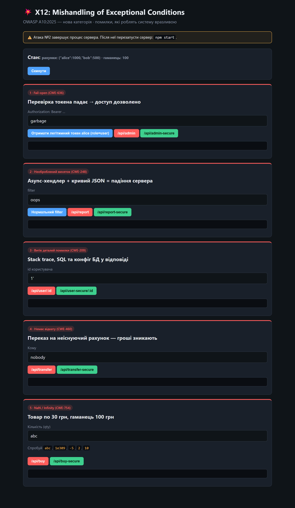

[🏠 Головна](../README.md) · [⬅ X11 Supply Chain](../X11_SupplyChain/README.md)

# 💥 X12: Mishandling of Exceptional Conditions

> **OWASP A10:2025 — Mishandling of Exceptional Conditions** 🆕 (нова категорія) · порт **3022** · CWE-636, CWE-248, CWE-209, CWE-460, CWE-754, CWE-369
>
> ⚠️ Атака №2 **вбиває процес сервера**. Після неї просто знову запусти `npm start`.



## 📋 Зміст

- [Мета](#-мета)
- [Запуск](#-запуск)
- [Вразливості](#-вразливості)
- [1. Fail-open](#1-fail-open-cwe-636)
- [2. Падіння сервера](#2-необроблений-виняток-cwe-248)
- [3. Витік деталей помилки](#3-витік-деталей-помилки-cwe-209)
- [4. Немає відкату](#4-немає-відкату-cwe-460)
- [5. NaN / від’ємні значення](#5-nan--infinity--відємні-значення-cwe-754)
- [Виправлення — загальні принципи](#-виправлення--загальні-принципи)
- [Завдання](#-завдання)
- [Джерела](#-джерела)

---

## 🎯 Мета

Нова категорія 2025 про те, що відбувається, **коли щось пішло не так**: система падає, відкриває доступ (fail-open), показує внутрішні деталі або залишає дані в неконсистентному стані. Лабораторна показує 5 типових помилок і їхні виправлення.

## 🚀 Запуск

```bash
cd X12_ExceptionalConditions
npm install
npm start          # http://127.0.0.1:3022
```

## 🚫 Вразливості

| # | Вразливо | Безпечно | CWE |
|---|---|---|---|
| 1 | `GET /api/admin` | `GET /api/admin-secure` | 636 Not Failing Securely |
| 2 | `GET /api/report?filter=` | `GET /api/report-secure?filter=` | 248 Uncaught Exception |
| 3 | `GET /api/user/:id` | `GET /api/user-secure/:id` | 209 Error Message with Sensitive Info |
| 4 | `POST /api/transfer` | `POST /api/transfer-secure` | 460 Improper Cleanup on Thrown Exception |
| 5 | `POST /api/buy` | `POST /api/buy-secure` | 754 / 369 Improper Check for Exceptional Conditions |

### 1. Fail-open (CWE-636)

```javascript
try {
    const payload = verifyToken(token);           // кидає на кривому токені
    if (payload.role !== 'admin') return 403;
} catch (e) {
    req.user = { role: 'admin' }; next();         // «щоб не ламати UX»
}
```

```bash
curl -H "Authorization: Bearer garbage" http://127.0.0.1:3022/api/admin
# {"secret":"FLAG{fail_open_auth_bypass}", ...}
```

Валідний токен з `role=user` отримує 403, а **сміття** отримує доступ адміна.

### 2. Необроблений виняток (CWE-248)

Express 4 **не ловить** помилки з `async`-хендлерів. `JSON.parse` на кривому вводі дає unhandled rejection, і Node завершує **весь процес**: один запит робить DoS для всіх користувачів.

```bash
curl "http://127.0.0.1:3022/api/report?filter=oops"   # сервер падає
```

### 3. Витік деталей помилки (CWE-209)

```bash
curl "http://127.0.0.1:3022/api/user/1'"
# {"error":"SQLITE_ERROR...","stack":"at findUser (C:\\...\\server.js:101)","query":"SELECT ...","config":{"password":"Pr0d_DB_P@ss"}}
```

Атакувальник отримує шляхи, структуру запитів, версії і навіть облікові дані БД.

### 4. Немає відкату (CWE-460)

```bash
curl -X POST http://127.0.0.1:3022/api/transfer -H "Content-Type: application/json" \
     -d '{"from":"alice","to":"nobody","amount":100}'
# помилка "Отримувача не знайдено", але alice: 900 — гроші зникли
```

Списання відбулось, зарахування кинуло виняток, і повернення коштів ніхто не передбачив.

### 5. NaN / Infinity / від’ємні значення (CWE-754)

Товар коштує 30, у гаманці 100:

| `qty` | Що відбувається |
|---|---|
| `"abc"` | `30 * NaN = NaN`; `NaN > 100` → `false` → перевірка «пройдена»; баланс стає `NaN` (`null` у JSON) |
| `"1e309"` | `Infinity` |
| `-5` | `total = -150` → баланс **зростає** до 250 |

## ✅ Виправлення — загальні принципи

```javascript
// 1. Fail closed: будь-яка помилка в перевірці безпеки = відмова
catch { return res.status(401).json({ error: 'Invalid token' }); }

// 2. Ловити помилки в async-коді (або Express 5 / express-async-errors)
app.get('/r', async (req, res, next) => { try { ... } catch (e) { next(e); } });
process.on('unhandledRejection', err => { log(err); /* graceful shutdown */ });

// 3. Клієнту — загальне повідомлення + ID інциденту, деталі — тільки в лог
const incident = crypto.randomUUID();
logger.error({ incident, err });
res.status(500).json({ error: 'Внутрішня помилка сервера', incident });

// 4. Валідація ДО зміни стану + транзакції з ROLLBACK
BEGIN; UPDATE ... ; UPDATE ... ; COMMIT;   -- або ROLLBACK при помилці

// 5. Позитивна валідація: Number.isInteger(qty) && qty >= 1 && qty <= 100
if (!(total <= balance)) reject();          // NaN дає false → відмова
```

Додатково: централізований error-handler, ліміти ресурсів (розмір тіла, таймаути), моніторинг падінь і алерти (зв’язок з [A09](../A09_SecurityLogging/README.md)).

## 🧪 Завдання

1. Отримай FLAG через fail-open без жодного валідного токена.
2. «Поклади» сервер одним запитом; поясни, чому `/api/report-secure` вистояв.
3. Знайди в помилці `/api/user/:id` пароль БД.
4. «Загуби» гроші alice через `/api/transfer`; переконайся, що `/api/transfer-secure` нічого не списує.
5. Отримай баланс `NaN` і баланс > 100 через `/api/buy`.

## 📚 Джерела

- [OWASP Top 10:2025 — A10 Mishandling of Exceptional Conditions](https://top10.owasp.org/2025/A10_2025-Mishandling_of_Exceptional_Conditions/)
- [OWASP Error Handling Cheat Sheet](https://cheatsheetseries.owasp.org/cheatsheets/Error_Handling_Cheat_Sheet.html)
- [Express — Error handling](https://expressjs.com/en/guide/error-handling.html)

---

[⬆ До змісту](#-зміст) · [🏠 Головна](../README.md)
